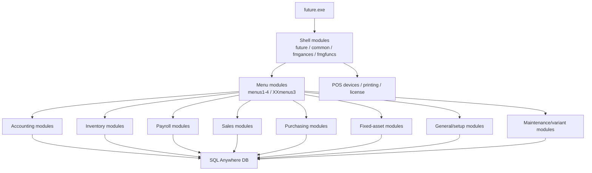
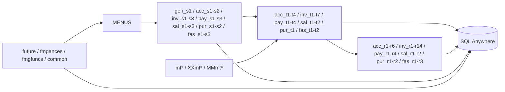

# Future 25 — application module catalog

**Date:** 2026-11-25  
**Baseline:** `D:\future_25` PowerBuilder library set  
**Cross-checks:** `D:\future_25 - Special`, `D:\future_25 old`, `D:\Future Elshamy`  
**Safety:** no executable was launched; no file on `D:` was modified.

## Confidence legend

- **[O]** Observed directly from static artifacts.
- **[I]** Inferred from naming conventions, object names, SQL strings, and schema.
- **[U]** Unknown; requires runtime trace or PBD decompilation.

---

## 1. Module inventory summary

`D:\future_25` contains **114 `.pbd` module libraries** **[O]**.

String-derived object totals from those libraries **[O]**:

| Object type | Total observed |
|---|---:|
| Windows (`*.win`) | 874 |
| DataWindows/DataStores (`*.dwo`) | 3,091 |
| User objects (`*.udo`) | 56 |
| Functions (`*.fun`) | 288 |
| Structures (`*.str`) | 72 |

`future.exe` embeds **105 `.pbd` references**, so the runtime library list is slightly smaller than the full on-disk set **[O]**. The remaining libraries may be loaded by companion executables, used as variants, or unused in that copy **[I]**.

---

## 2. Module naming convention

PowerBuilder libraries follow a strong naming pattern **[O]**, with roles inferred as shown **[I]**.

| Pattern | Meaning | Example |
|---|---|---|
| `<domain>_g#` | Global/general helpers, choice windows, shared DataWindows for the domain | `acc_g1.pbd`, `inv_g1.pbd`, `pay_g1.pbd` |
| `<domain>_r#` | Reports and report windows | `acc_r2.pbd`, `inv_r5.pbd`, `pay_r4.pbd` |
| `<domain>_s#` | Setup/maintenance screens | `acc_s2.pbd`, `inv_s2.pbd`, `sal_s1.pbd` |
| `<domain>_t#` | Transaction entry windows | `acc_t4.pbd`, `inv_t2.pbd`, `fas_t1.pbd` |
| `future*` | Application shell, login, security, protection, shared dropdowns | `future.pbd`, `future_dd1.pbd` |
| `common`, `fmgances`, `fmgfuncs` | Shared UI base, DataWindows, helper functions | `fmgances.pbd`, `fmgfuncs.pbd` |
| `menus*` | Menu libraries | `menus1.pbd`–`menus4.pbd`, `XXmenus3.pbd` |
| `mt*`, `MMmt*`, `XXmt*` | Maintenance/light/custom variants of modules | `mtinv.pbd`, `XXmtacc.pbd` |
| `rep_*`, `rlcomm`, `tr_data` | Support utilities, communications, transaction data objects | `rep_branchs.pbd`, `rlcomm.pbd` |

---

## 3. Module family map



### Family totals

| Family | Libraries | Windows | DataWindows | Functions | Main role |
|---|---:|---:|---:|---:|---|
| Inventory (`inv*`) | 28 | 283 | 1,326 | 35 | Item, store, balance, issue/receipt/transfer, reports |
| Payroll (`pay*`) | 14 | 168 | 413 | 46 | Employee, attendance, salary, payslip, reports |
| Accounting (`acc*`) | 13 | 99 | 370 | 10 | GL, vouchers, accounts, balances, cost centers, budgets |
| Fixed assets (`fas*`) | 12 | 27 | 166 | 44 | Asset cards, classes, transfers, depreciation |
| Sales (`sal*`) | 8 | 84 | 302 | 10 | Customers, prices, sales reports, call center |
| Purchasing (`pur*`) | 7 | 57 | 153 | 21 | Vendors, POs, requisitions, vendor reports |
| General/setup (`gen*`) | 2 | 52 | 101 | 0 | System parameters, security templates, shared choices |
| Shell/shared (`future*`, `common`, `fmgances`, `fmgfuncs`) | 5 | 46 | 167 | 84 | Login, frame, menus base, reusable functions |
| Menus (`menus*`, `XXmenus3`) | 5 | 0 | 0 | 0 | Compiled menu definitions |
| Maintenance/variants (`mt*`, `MMmt*`, `XXmt*`) | 17 | 29 | 51 | 3 | Light/custom transaction variants |
| Support/integration (`rep_branchs`, `rlcomm`, `tr_data`) | 3 | 11 | 38 | 11 | Scripts, equations, transaction data objects |

---

## 4. Shell and shared framework modules

| Module | Win | Dwo | Udo | Fun | Str | Representative objects / role |
|---|---:|---:|---:|---:|---:|---|
| `future.pbd` | 17 | 12 | 9 | 17 | 7 | `w_change_password`, `w_genapp_about`, `w_genapp_frame`, `w_logon`, `w_sec`, `w_protect`, `n_appmanager`, `f_encrypte_x`, `f_decrypte_x` — application shell, login, security, protection **[O]** |
| `future_dd1.pbd` | 0 | 17 | 0 | 0 | 0 | `dddw_comp_nature`, `dddw_comp_type` — shared dropdown DataWindows **[O]** |
| `common.pbd` | 14 | 136 | 14 | 3 | 7 | `security_info`, `shortcut_setup`, `system_parameter`, `w_barcode`, `w_message` — shared UI and device/message screens **[O]** |
| `fmgances.pbd` | 15 | 2 | 13 | 0 | 4 | `w_base_choice`, `w_generic_choice`, `w_header_lines`, `w_master_detail`, `uo_dw_master`, `uo_dw_detail`, `n_trans` — reusable base framework **[O]** |
| `fmgfuncs.pbd` | 0 | 0 | 0 | 64 | 0 | `f_build_where`, `f_db_col_names`, `f_fill_db_info`, `f_check_expiry_balance`, `f_company_fiscal_year` — global helper library **[O]** |

Shell responsibilities **[I]**:

- start login/security/protection sequence,
- open the main frame and toolbars,
- load menus,
- provide shared validation and fiscal-period helpers,
- provide master/detail and header/detail base windows,
- expose encryption/protection helpers.

---

## 5. Menu modules

| Module | Win | Dwo | Udo | Fun | Str | Notes |
|---|---:|---:|---:|---:|---:|---|
| `menus1.pbd` | 0 | 0 | 0 | 0 | 0 | Large compiled menu library; no menu objects exposed to string scan **[O]/[I]** |
| `menus2.pbd` | 0 | 0 | 0 | 0 | 0 | Compiled menu library **[O]/[I]** |
| `menus3.pbd` | 0 | 0 | 0 | 0 | 0 | Compiled menu library **[O]/[I]** |
| `menus4.pbd` | 0 | 0 | 0 | 0 | 0 | Compiled menu library **[O]/[I]** |
| `XXmenus3.pbd` | 0 | 0 | 0 | 0 | 0 | Variant/alternate menu library **[O]/[I]** |

Observed menu-related labels embedded in menu libraries include `Cost Centers`, `Cost Centers Tree`, `Company Cost Centers`, `Budget Report`, `Cost Center / Acc.(s) Report`, `Cost Center Transfer` **[O]**. Full menu structure is unknown **[U]**.

---

## 6. Accounting modules (`acc*`)

Role **[I]**: chart of accounts, GL vouchers, cash/paper transactions, balances, cost centers, budgets, accounting reports.

| Module | Win | Dwo | Fun | Str | Representative objects / role |
|---|---:|---:|---:|---:|---|
| `acc_g1.pbd` | 0 | 16 | 6 | 0 | Chart-of-account selection DataWindows; account tree helpers **[O]** |
| `acc_r1.pbd` | 10 | 56 | 0 | 1 | `w_bank_acc_balance_sum_*`, `w_paper_follow_up_*` — bank/paper follow-up reports **[O]** |
| `acc_r2.pbd` | 20 | 36 | 0 | 0 | `w_acc_cost_center_report_eng`, `w_acc_trans_detailed_*`, trial balance/cost-center reports **[O]** |
| `acc_r3.pbd` | 16 | 76 | 3 | 1 | `w_acc_cost_center_report_arb`, `w_aging_paper_*`, `w_budget_report_*` **[O]** |
| `acc_r4.pbd` | 1 | 19 | 0 | 0 | `w_total_in_out_cash_comp_arb` — cash in/out totals **[O]** |
| `acc_r5.pbd` | 0 | 6 | 0 | 0 | `d_item_stok_balance_g1..g6` — stock balance report DataWindows reused in accounting **[O]** |
| `acc_r6.pbd` | 0 | 6 | 0 | 0 | `d_print_any_rep3..6` — generic print layouts **[O]** |
| `acc_s1.pbd` | 9 | 15 | 0 | 0 | `w_maint_ml_account_chart_tree_*`, `w_maint_module_trans_gl_acc_*` — chart/account setup **[O]** |
| `acc_s2.pbd` | 19 | 49 | 0 | 0 | `w_maint_acc_open_bal_*`, `w_maint_budget_*`, cost-center maintenance windows **[O]** |
| `acc_t1.pbd` | 1 | 18 | 1 | 1 | `w_anc_trans_gl` — GL transaction helper/DataWindows **[O]** |
| `acc_t2.pbd` | 10 | 28 | 0 | 0 | `w_header_lines_cash_adjust_*`, `w_header_lines_cash_out_*` — cash transactions **[O]** |
| `acc_t3.pbd` | 6 | 25 | 0 | 0 | `w_header_lines_paper_dep_*`, `w_header_lines_paper_out_*` — paper/check transactions **[O]** |
| `acc_t4.pbd` | 7 | 20 | 0 | 1 | `w_gl_voucher_detail_distribute_*`, `w_header_lines_auto_*` — GL voucher distribution **[O]** |

Accounting module flow **[I]**:

```text
acc_s1/acc_s2 setup
  -> acc_t1-t4 transaction entry
  -> GL_JOURNAL_VOUCHER_HEADER/DETAIL + GL_VOUCHER_DETAIL_DIST
  -> acc_r1-r6 reports
```

---

## 7. Inventory modules (`inv*`)

Role **[I]**: item master, stores, prices, balances, expiry, issue/receive/transfer/return transactions, inventory reports and labels.

| Module | Win | Dwo | Udo | Fun | Str | Representative objects / role |
|---|---:|---:|---:|---:|---:|---|
| `inv_g1.pbd` | 1 | 49 | 5 | 12 | 3 | `w_choice_it_un_convr`, `of_get_item_cost`, `of_get_item_acc_cost` — item cost/unit helpers **[O]** |
| `inv_r1.pbd` | 19 | 27 | 0 | 0 | 0 | `w_exp_date_report_*`, `w_header_lines_issue_print_*` — expiry/issue print reports **[O]** |
| `inv_r2.pbd` | 8 | 148 | 0 | 8 | 0 | `w_estimate_of_request_report_*`, `w_follow_of_total_trans_report_*` — request/follow-up reports **[O]** |
| `inv_r3.pbd` | 6 | 71 | 0 | 0 | 0 | `w_new_items_from_date_to_date_report_*`, `w_sales_of_item_country_*` **[O]** |
| `inv_r4.pbd` | 14 | 46 | 0 | 2 | 0 | `w_cus_sales_item_report_*`, `w_not_posted_items_*` **[O]** |
| `inv_r5.pbd` | 38 | 116 | 0 | 17 | 0 | `w_balance_report_*`, `w_balance_group_report_*` — largest inventory report module **[O]** |
| `inv_r6.pbd` | 16 | 112 | 0 | 0 | 0 | `w_item_iss_ratr_crostab_*`, `w_item_stok_crostab_*` — cross-tab reports **[O]** |
| `inv_r7.pbd` | 22 | 62 | 0 | 3 | 1 | `w_balance_report2_*`, `w_day_sales_crostab_*` **[O]** |
| `inv_r8.pbd` | 13 | 58 | 0 | 1 | 0 | `w_comp_prod_report_*`, `w_exp_date_report_new_*`, item-cost-per-store reports **[O]** |
| `inv_r9.pbd` | 10 | 31 | 0 | 3 | 0 | `w_ct_item_store_*`, `w_damage_report_*` **[O]** |
| `inv_r10.pbd` | 6 | 25 | 0 | 0 | 0 | `w_cus_contract_detail_*`, `w_item_bal_sugest_pur_*` — purchase suggestion reports **[O]** |
| `inv_r1055.pbd` | 5 | 24 | 0 | 0 | 0 | Variant of purchase-suggestion/shortage reports **[O]/[I]** |
| `inv_r11.pbd` | 5 | 7 | 0 | 0 | 0 | `w_center`, `w_daily_trans1_*`, `w_dw_print_options` **[O]** |
| `inv_r12.pbd` | 0 | 1 | 0 | 0 | 0 | `ds_laser_label_std6x12_hemmat1` — label DataStore **[O]** |
| `inv_r13.pbd` | 2 | 10 | 0 | 1 | 0 | `w_sql_scheduale`, `w_syb_scheduale` — scheduling utilities **[O]/[I]** |
| `inv_r14.pbd` | 0 | 2 | 0 | 1 | 0 | Barcode/label DataStores **[O]** |
| `inv_r15.pbd` | 0 | 0 | 0 | 0 | 0 | Near-empty placeholder module **[O]/[I]** |
| `inv_s1.pbd` | 16 | 68 | 0 | 1 | 1 | `w_alternate_items_*`, `w_drug_items_*` — item setup variants **[O]** |
| `inv_s2.pbd` | 31 | 80 | 0 | 0 | 0 | `w_item_picture`, `w_item_unit_conversion_*`, `w_maint_item_category_*` **[O]** |
| `inv_s3.pbd` | 25 | 42 | 0 | 0 | 0 | `w_item_codes_*`, `w_item_comp_price_*`, cost-center/store setup **[O]** |
| `inv_t1.pbd` | 5 | 36 | 0 | 0 | 1 | `w_header_lines_adjustment_*`, `w_header_lines_receive1_*` **[O]** |
| `inv_t2.pbd` | 10 | 58 | 1 | 4 | 1 | `w_header_lines_issue_*`, job-order fields, issue transactions **[O]** |
| `inv_t3.pbd` | 5 | 25 | 0 | 0 | 1 | `w_header_lines_receive_*`, `w_print_2_recieve_*` **[O]** |
| `inv_t4.pbd` | 6 | 26 | 0 | 0 | 0 | `w_header_lines_adding_transfere_*`, `w_header_lines_issue_transfere_*` **[O]** |
| `inv_t5.pbd` | 13 | 57 | 0 | 1 | 0 | `w_header_lines_issue_return_*`, `w_header_lines_store_op_*` **[O]** |
| `inv_t58.pbd` | 12 | 48 | 0 | 1 | 0 | Issue/vendor-return variant **[O]/[I]** |
| `inv_t6.pbd` | 7 | 70 | 0 | 0 | 1 | `w_issue_add_expiry`, `w_issue_drug_interaction_*`, expiry/food/drug checks **[O]** |
| `inv_t7.pbd` | 5 | 27 | 0 | 7 | 0 | `w_header_lines_issue1_*`, `w_issue_salesorder_*`, issue variants **[O]** |

Inventory module flow **[I]**:

```text
inv_s1-s3 setup
  -> inv_t1-t7 transactions
  -> balance_* / system_balance / item_store_company updates
  -> inv_r1-r14 reports/labels
```

---

## 8. Payroll modules (`pay*`)

Role **[I]**: employees, banks, holiday rules, attendance, salary calculation, deductions/allowances, payroll reports.

| Module | Win | Dwo | Udo | Fun | Str | Representative objects / role |
|---|---:|---:|---:|---:|---:|---|
| `pay_g1.pbd` | 1 | 6 | 1 | 32 | 7 | `w_emp_arb`, payroll helper functions, cost-center/budget helpers **[O]** |
| `pay_r1.pbd` | 19 | 62 | 0 | 0 | 1 | `w_emp_vac_balance_*`, `w_emp_vac_detail_*` — vacation/balance reports **[O]** |
| `pay_r2.pbd` | 21 | 17 | 0 | 2 | 0 | `w_delay_report_*`, `w_header_lines_jv_setup_*` — delays and JV setup **[O]** |
| `pay_r3.pbd` | 16 | 46 | 0 | 1 | 0 | `w_banks_emp_report_*`, `w_emp_banks_report_*` **[O]** |
| `pay_r4.pbd` | 24 | 30 | 0 | 8 | 4 | `w_dep_delay_report_*`, `w_emp_delay_report_*` **[O]** |
| `pay_r5.pbd` | 0 | 0 | 0 | 0 | 0 | Near-empty placeholder **[O]/[I]** |
| `pay_r6.pbd` | 0 | 0 | 0 | 0 | 0 | Near-empty placeholder **[O]/[I]** |
| `pay_s1.pbd` | 40 | 2 | 0 | 0 | 0 | `w_header_lines_emp_banks_*`, `w_header_lines_holiday_rule_*` — employee setup **[O]** |
| `pay_s2.pbd` | 0 | 67 | 0 | 0 | 0 | Arabic deduction/allowance DataWindows **[O]** |
| `pay_s3.pbd` | 0 | 64 | 0 | 0 | 0 | English deduction/allowance DataWindows **[O]** |
| `pay_t1.pbd` | 21 | 6 | 0 | 0 | 0 | `w_all_sheet_*`, `w_header_lines_all_accum_*` — attendance/accumulation **[O]** |
| `pay_t2.pbd` | 14 | 29 | 0 | 1 | 0 | `w_calc_salary`, `w_calc_salary_org`, medical insurance **[O]** |
| `pay_t3.pbd` | 0 | 49 | 0 | 0 | 0 | Accumulation header/detail DataWindows **[O]** |
| `pay_t4.pbd` | 12 | 35 | 0 | 0 | 0 | `w_confirm_attend_sheet_*`, `w_maint_att_sheet_*` **[O]** |

Payroll module flow **[I]**:

```text
pay_g1/pay_s1-s3 setup
  -> pay_t1/pay_t4 attendance
  -> pay_t2 salary calculation
  -> payroll posting with cost center
  -> pay_r1-r4 reports
```

---

## 9. Sales modules (`sal*`)

Role **[I]**: customers, prices/contracts, sales analysis, customer help, call-center conversion.

| Module | Win | Dwo | Fun | Str | Representative objects / role |
|---|---:|---:|---:|---:|---|
| `sal_g1.pbd` | 3 | 16 | 4 | 0 | `w_customer_dis_report_*`, `w_header_line_contracts_*`, `w_special_items_dist` **[O]** |
| `sal_r1.pbd` | 16 | 55 | 0 | 0 | `w_aging_report_*`, `w_cus_ven_card_data_*` — customer aging/card reports **[O]** |
| `sal_r2.pbd` | 13 | 44 | 2 | 0 | `w_cs_most_req_items_rep_*`, `w_cs_waiting_items_rep_*`, call-center totals **[O]** |
| `sal_s1.pbd` | 10 | 47 | 1 | 0 | `w_maint_price_type_*`, `w_mdt_customer_*` — customer/price setup **[O]** |
| `sal_s2.pbd` | 10 | 43 | 0 | 1 | `w_header_lines_cus_facility_*` — customer facility/copy **[O]** |
| `sal_s3.pbd` | 16 | 35 | 3 | 0 | `w_customer_without_gl_*`, `w_header_lines_cust_diseases_*` **[O]** |
| `sal_t1.pbd` | 7 | 22 | 0 | 0 | `w_cus_help_*`, `w_header_lines_bonus_*` — customer help/bonus **[O]** |
| `sal_t2.pbd` | 9 | 40 | 0 | 0 | `w_convert_cust_to_callcenter_*`, `w_cust_new_phone_*` **[O]** |

---

## 10. Purchasing modules (`pur*`)

Role **[I]**: vendors, vendor-item relationships, RFQ, purchase orders, requisitions, B2B printing, purchase reports.

| Module | Win | Dwo | Fun | Str | Representative objects / role |
|---|---:|---:|---:|---:|---|
| `pur_g1.pbd` | 3 | 9 | 1 | 0 | `w_choice_item_company_vendor`, `w_choice_rfq_vendor`, `w_choice_vendor_company` **[O]** |
| `pur_r1.pbd` | 14 | 22 | 19 | 1 | `w_acc_ratr_issue_balance_sheet_*`, purchase/issue reports, balance helpers **[O]** |
| `pur_r2.pbd` | 9 | 21 | 0 | 0 | `w_po_from_date_to_date_*`, `w_po_from_date_to_date_b2b_*` **[O]** |
| `pur_r3.pbd` | 0 | 0 | 0 | 0 | Near-empty placeholder **[O]/[I]** |
| `pur_s1.pbd` | 8 | 18 | 0 | 0 | `w_maint_company_vendors_*`, `w_maint_item_company_vendors_*` **[O]** |
| `pur_s2.pbd` | 11 | 18 | 0 | 1 | `w_select_company_vendors_*`, `w_select_items_company_vendors_*` **[O]** |
| `pur_t1.pbd` | 12 | 65 | 1 | 1 | `w_header_lines_po_*`, `w_header_lines_requisition`, `w_b2bprint` **[O]** |

---

## 11. Fixed-asset modules (`fas*`)

Role **[I]**: asset cards/classes, depreciation equations, asset transactions, transfers, barcode labels, asset reports.

| Module | Win | Dwo | Udo | Fun | Str | Representative objects / role |
|---|---:|---:|---:|---:|---:|---|
| `fas_g1.pbd` | 3 | 14 | 2 | 14 | 11 | `w_choice_assetclass_*`, `af_costcenter_data`, `ds_costcenter_data` **[O]** |
| `fas_g2.pbd` | 2 | 20 | 0 | 16 | 0 | `w_please_wait`, `w_recieve_calls`, asset helper functions **[O]** |
| `fas_g3.pbd` | 2 | 14 | 1 | 0 | 1 | `w_equation_setup_*`, depreciation equation DataStores **[O]** |
| `fas_r1.pbd` | 4 | 8 | 0 | 0 | 0 | `w_asset_barcode_print_*`, `w_fas_anc_report_*`, cost-center transfer labels **[O]** |
| `fas_r2.pbd` | 1 | 2 | 0 | 0 | 0 | `w_item_barcode_print_arb` **[O]** |
| `fas_r3.pbd` | 0 | 1 | 0 | 0 | 0 | `d_sales_report_arb` **[O]** |
| `fas_s1.pbd` | 10 | 26 | 0 | 8 | 0 | `w_fas_asset_card_*`, `w_fas_asset_class_*` **[O]** |
| `fas_s2.pbd` | 1 | 8 | 0 | 2 | 0 | `w_follow_up_transfer_between_branch_*`, job-order fields **[O]** |
| `fas_s3.pbd` | 0 | 0 | 0 | 0 | 0 | 4 KB placeholder **[O]/[I]** |
| `fas_t1.pbd` | 2 | 73 | 0 | 4 | 0 | `w_header_lines_asset_trans_*`, asset transaction DataWindows **[O]** |
| `fas_t2.pbd` | 2 | 0 | 0 | 0 | 0 | `w_fas_open_posting_*` **[O]** |
| `fas_t3.pbd` | 0 | 0 | 0 | 0 | 0 | 4 KB placeholder **[O]/[I]** |

---

## 12. General/setup modules (`gen*`)

Role **[I]**: system parameters, security templates, general choice windows, cost-center tree maintenance.

| Module | Win | Dwo | Udo | Fun | Str | Representative objects / role |
|---|---:|---:|---:|---:|---:|---|
| `gen_g1.pbd` | 5 | 14 | 3 | 0 | 0 | `w_choice_currencies`, `w_choice_item_company`, `w_maint_sheet` **[O]** |
| `gen_s1.pbd` | 47 | 87 | 0 | 0 | 0 | `security_info`, `security_template`, `system_parameter`, `w_maint_ml_cost_centers_*`, `w_get_balance_from_transaction_*` **[O]** |

---

## 13. Maintenance and variant modules (`mt*`, `MMmt*`, `XXmt*`)

Role **[I]**: alternate/light/custom transaction modules. Several are tiny 4 KB placeholders or variant libraries.

| Module | Win | Dwo | Fun | Str | Representative objects / role |
|---|---:|---:|---:|---:|---|
| `MMmtacc.pbd` | 0 | 0 | 0 | 0 | 4 KB placeholder/accounting variant **[O]/[I]** |
| `MMmtinv.pbd` | 4 | 6 | 1 | 0 | `w_header_lines_issue_*`, `w_item_price_*` **[O]** |
| `mtacc.pbd` | 6 | 14 | 0 | 0 | `w_daily_transaction_detail_*`, cash receipt/out variants **[O]** |
| `mtaccb.pbd` | 0 | 0 | 0 | 0 | 4 KB placeholder **[O]/[I]** |
| `mtcomm.pbd` | 0 | 0 | 0 | 0 | Communication/user-object variant **[O]** |
| `mtgen.pbd` | 0 | 0 | 0 | 0 | 4 KB placeholder **[O]/[I]** |
| `mtinv.pbd` | 7 | 11 | 0 | 0 | `w_header_lines_issue_*`, receive/return/transfer variants **[O]** |
| `mtinvb.pbd` | 1 | 4 | 0 | 1 | `w_header_lines_adjustment_arb` **[O]** |
| `mtinvc.pbd` | 0 | 1 | 0 | 0 | `d_st_receive_header_arb` **[O]** |
| `mtinvd.pbd` | 0 | 0 | 0 | 0 | 4 KB placeholder **[O]/[I]** |
| `mtpay.pbd` | 2 | 0 | 0 | 0 | `w_confirm_attend_sheet_*`, `w_maint_att_sheet_*` **[O]** |
| `mtpayb.pbd` | 0 | 0 | 0 | 0 | 4 KB placeholder **[O]/[I]** |
| `mtpro.pbd` | 0 | 0 | 0 | 0 | 4 KB placeholder / production variant **[O]/[I]** |
| `mtpur.pbd` | 0 | 0 | 0 | 0 | 4 KB placeholder / purchasing variant **[O]/[I]** |
| `mtsal.pbd` | 1 | 0 | 0 | 0 | `w_shift_handing_arb` **[O]** |
| `XXmtacc.pbd` | 4 | 7 | 0 | 1 | Cash receipt/out variants, `w_print_any` **[O]** |
| `XXmtinv.pbd` | 5 | 12 | 1 | 0 | `w_header_lines_issue_*`, receive/price variants **[O]** |

---

## 14. Support and integration modules

| Module | Win | Dwo | Udo | Fun | Str | Role |
|---|---:|---:|---:|---:|---:|---|
| `rep_branchs.pbd` | 11 | 5 | 4 | 1 | 0 | `w_run_scripts`, `w_encrypte_decrypte`, `form1`, `w_cus` — support/report/encryption utilities **[O]** |
| `rlcomm.pbd` | 0 | 16 | 2 | 7 | 11 | `d_equation_pay1000`, `d_equation_stk3000`, transaction equation DataObjects **[O]** |
| `tr_data.pbd` | 0 | 17 | 0 | 3 | 0 | `d_com_vendors`, `d_ext_master`, transaction/external data objects **[O]** |

`run_scripts.exe` in the Special copy references `rep_branchs.pbd` and `w_run_scripts_support_25.win`, confirming a companion utility role **[O]**.

---

## 15. Module-to-database mapping

| Module family | Main tables evidenced in SQL/DDL |
|---|---|
| Accounting | `COMPANY`, `CHART_OF_ACCOUNTS`, `COMPANY_CHART_OF_ACCOUNT`, `GL_JOURNAL_VOUCHER_HEADER`, `GL_JOURNAL_VOUCHER_DETAIL`, `GL_VOUCHER_DETAIL_DIST`, `SYSTEM_BALANCE`, `GL_BUDGET` |
| Inventory | `ITEM_MASTER`, `ITEM_GROUPS`, `ITEM_COMPANY`, `ITEM_STORE_COMPANY`, `ISSUE_TRANS_HEADER`, `ISSUE_TRANSACTION_ITEMS`, `BALANCE_*`, `ITEM_STORE_COMPANY_EXPIRY` |
| Sales | `CUSTOMER`, `CUSTOMER_COMAPNY`, `RATR_TRANSACTION_HEADER`, `RATR_TRANSACTION_ITEMS`, price/customer tables |
| Purchasing | `VENDOR`, `COMPANY_VENDORS`, `PURCHASE_ORDER_HEADER`, purchase/requisition/vendor-item tables |
| Payroll | `EMPLOYEE`, `TIME_SHEET_TRANSACTION`, `ATTENDANCE`, `PAYSLIP_MONTHLY_COPY`, allowance/deduction tables, `payroll_jv_acc_header_setup` |
| Fixed assets | `fa_asset_card`, `fa_asset_trans_detail`, `fa_dep_journal_voucher_detail`, `equation_setup_journal` |
| Cost control | `COST_CENTERS`, `COMPANY_COST_CENTERS`, `GL_COST_CENTER_DETAIL`, `GL_COST_CENTER_SUMMERY` |
| Setup/shared | `CURRENCY`, `STORES`, `USER_COMPANY_STORE`, `MODULE_TRANSACTIONS`, `SECURITY_*` |

Full DDL: `future25_schema.sql`.

---

## 16. Deployment observations

| Copy | Module-set observation |
|---|---|
| `D:\future_25` | 114 PBDs — baseline catalog above |
| `D:\future_25 old` | 114 PBDs, same family structure **[O]** |
| `D:\future_25 - Special` root | 114 PBDs, same names as baseline **[O]** |
| `D:\future_25 - Special\future_25` | Second nested copy of 114 PBDs; all 114 files hash-identical to root copy **[O]** |
| `D:\Future Elshamy` | 117 PBDs; includes additional executable/library variants **[O]** |

The Special copy’s “228 PBDs” count is therefore **two identical 114-library sets**, not 228 distinct modules **[O]**.

---

## 17. Placeholder and empty modules

Several PBDs are only 4 KB and expose no string-visible objects:

- `fas_s3.pbd`
- `fas_t3.pbd`
- `inv_r15.pbd`
- `MMmtacc.pbd`
- `mtaccb.pbd`
- `mtgen.pbd`
- `mtinvd.pbd`
- `mtpayb.pbd`
- `mtpro.pbd`
- `mtpur.pbd`
- `pur_r3.pbd`
- `pay_r5.pbd`
- `pay_r6.pbd`

Interpretation **[I]**: these are likely placeholders, disabled modules, or compiled containers whose object names are not exposed to a byte-string scan. They may still contain PowerBuilder compilation metadata not recovered here.

---

## 18. Module dependency summary



Key architectural observation **[I]**: the application is organized as **setup → transaction → report** triples inside each business domain, with shared shell/framework libraries underneath.

---

## 19. Unknowns

- Exact menu hierarchy and menu item-to-PBD mapping **[U]**.
- Whether every cataloged PBD is loaded by `future.exe` at runtime **[U]**.
- Purpose of tiny placeholder libraries **[U]**.
- Event scripts and business rules inside PBD bytecode **[U]**.
- Exact reason for the duplicated Special nested copy **[U]**.
- Whether `inv_r1055`, `inv_t58`, `XXmt*`, and `MMmt*` are active customized variants or archived branches **[U]**.

---

## 20. Related documents

- Architecture: `future_25_architecture.md`
- Workflow: `future_25_app_workflow.md`
- UI map: `future_25_app_ui.md`
- Cost-control focus: `future_25_cost_control.md`
- Static analysis: `future_25_static_analysis.md`
- Full recovered schema: `future25_schema.sql`
- Schema report: `future25_schema_report.md`

---

## 21. Bottom line

Future 25 is packaged as **114 PowerBuilder PBD modules** organized into clear domain families:

- inventory is the largest family,
- accounting, payroll, sales, purchasing, and fixed assets follow the same setup/transaction/report pattern,
- shell and shared libraries provide login, frame, base windows, functions, and DataWindows,
- menu libraries are compiled and not string-visible,
- maintenance/variant libraries provide light or customized transaction flows,
- the Special copy contains two identical module sets rather than 228 distinct modules.

The catalog above is a static inventory; actual runtime loading and event logic remain unknown without decompilation or tracing.
