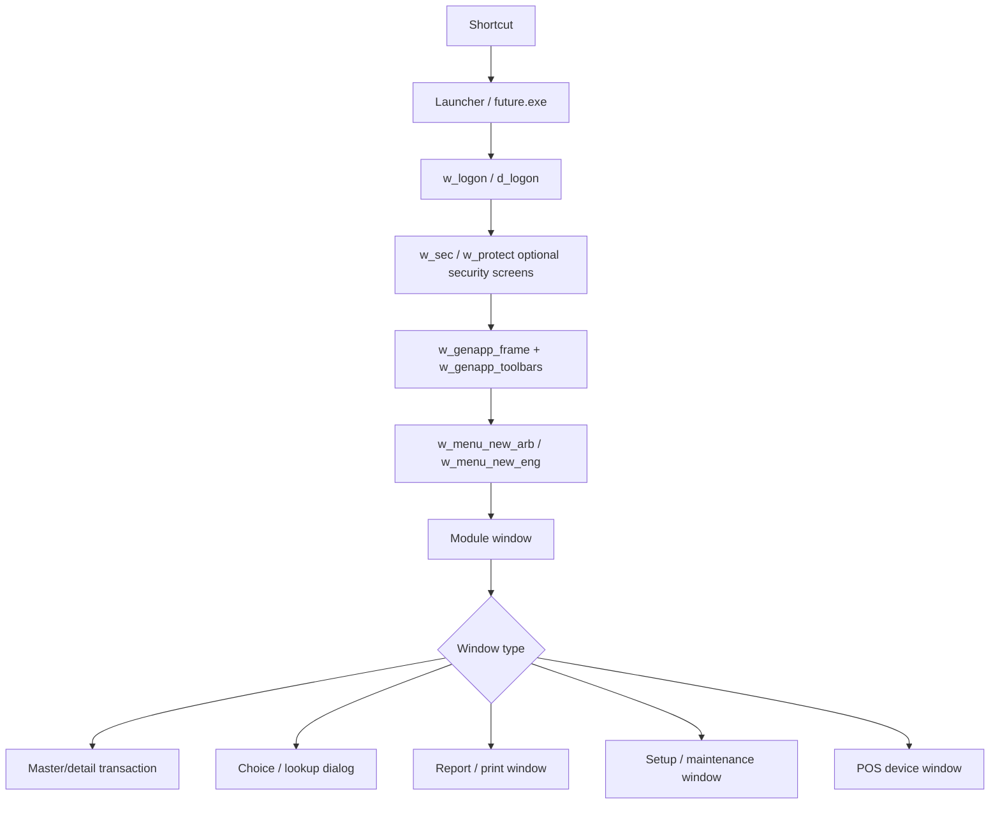
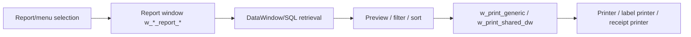

# Future 25 — application UI map

**Date:** 2026-11-25  
**Scope:** PowerBuilder UI objects recovered from the `.pbd` libraries in `D:\future_25`, with cross-copy checks in `D:\future_25 - Special`, `D:\future_25 old`, and `D:\Future Elshamy`.  
**Constraint:** no executable was launched; no screenshot or live UI capture was taken.

## Confidence legend

- **[O]** Observed object name or config setting in static artifacts.
- **[I]** Inferred role from object name, library family, or related objects.
- **[U]** Unknown; requires launching/decompiling/capturing the UI.

---

## 1. UI summary

Future 25 uses a classic **PowerBuilder 9 desktop UI**:

- MDI-style main frame with toolbars and menus **[I]**.
- Many modal/non-modal windows (`w_*`) **[O]**.
- DataWindow-based forms, grids, and reports (`d_*`, `ds_*`) **[O]**.
- Reusable custom user objects for master/detail editing, choice dialogs, printing, and transactions **[O]**.
- Arabic and English screen variants (`_arb`, `_eng`) **[O]**.

Baseline object counts from `D:\future_25`:

| UI object type | Unique objects |
|---|---:|
| Windows (`*.win`) | 826 |
| DataWindows (`*.dwo`) | 2,925 |
| Arabic windows (`*_arb.win`) | 405 |
| English windows (`*_eng.win`) | 327 |
| Language-neutral windows | 94 |

The Special copy contains a larger PBD set (228 vs 114), so its UI object inventory is likely larger **[I]**.

---

## 2. UI object naming conventions

| Prefix/suffix | Meaning | Example |
|---|---|---|
| `w_` | PowerBuilder window | `w_logon.win`, `w_genapp_frame.win` |
| `d_` | DataWindow object, often a form or report layout | `d_logon.dwo`, `d_item_master.dwo` |
| `ds_` | DataStore / non-visual DataWindow | `ds_opened_sheft.dwo` |
| `uo_` | Custom user object, often reusable UI control | `uo_dw_master.udo`, `uo_dw_detail.udo` |
| `n_` | Non-visual custom class | `n_appmanager.udo`, `n_trans.udo` |
| `str_` | Structure used to pass UI/session data | `str_logon.str`, `str_sys_par.str` |
| `_arb` | Arabic UI variant | `w_menu_new_arb.win` |
| `_eng` | English UI variant | `w_menu_new_eng.win` |

Menu libraries `menus1.pbd`–`menus4.pbd` were observed, but no `.mnu` string entries were recoverable by the read-only scan; menu definitions are likely stored in PowerBuilder compiled form **[O]/[U]**.

---

## 3. UI flow



---

## 4. Startup and shell UI

Objects in `future.pbd` **[O]**:

| Object | Role |
|---|---|
| `w_logon.win`, `d_logon.dwo` | Login screen |
| `d_logonold.dwo` | Older login layout |
| `w_change_password.win`, `change_pass.fun` | Password change |
| `w_sec.win`, `w_protect.win` | Security/protection screens |
| `w_genapp_frame.win`, `w_genapp_frame_arb.win`, `w_genapp_frame_eng.win` | Main application frame |
| `w_genapp_toolbars.win`, `_arb`, `_eng` | Toolbar windows |
| `w_menu_new_arb.win`, `w_menu_new_eng.win` | Main menu windows |
| `w_empty_module.win` | Placeholder/empty module screen |
| `w_genapp_about.win`, `_arb`, `_eng` | About dialog |
| `w_header_lines.win` | Shared header/detail form |
| `n_appmanager.udo` | Application manager object |
| `str_logon.str`, `str_sys_par.str` | Logon/session structures |

Inferred shell flow:

```text
w_logon
  -> security/protection check
  -> w_genapp_frame
  -> w_genapp_toolbars
  -> w_menu_new_arb / w_menu_new_eng
  -> module-specific window
```

The presence of separate Arabic/English frame, toolbar, and menu windows suggests the UI language is selected at runtime or by a module/language setting **[I]**.

---

## 5. Shared UI framework

### 5.1 `fmgances.pbd` — reusable UI base

Observed **[O]**:

- `w_base_choice.win`
- `w_generic_choice.win`
- `w_generic_choice_search.win`
- `w_header_lines.win`
- `w_header_lines_2.win`
- `w_master_detail.win`
- `w_master_detail_tab.win`
- `w_maint_multilevels.win`
- `w_mlevels_help.win`
- `w_mlevels_select.win`
- `w_mlevels_select_arg.win`
- `w_print_generic.win`
- `w_print_shared_dw.win`
- `uo_dw_master.udo`
- `uo_dw_detail.udo`
- `uo_dw_header_master.udo`
- `uo_dw_header_detail.udo`
- `uo_dw_lines_master.udo`
- `uo_dw_lines_detail.udo`
- `uo_dw_finder.udo`
- `uo_dw_sorter.udo`
- `n_dbasehandle.udo`
- `n_trans.udo`

Role inference **[I]**:

| Pattern | Purpose |
|---|---|
| `w_header_lines*` + `uo_dw_header_*` + `uo_dw_lines_*` | Header/detail transaction entry |
| `w_master_detail*` | Master/detail browsing/editing |
| `w_generic_choice*` / `w_base_choice` | Lookup/value-selection dialogs |
| `w_mlevels_*` | Multi-level selection/tree dialogs |
| `uo_dw_finder`, `uo_dw_sorter` | Search/filter/sort behavior |
| `w_print_generic`, `w_print_shared_dw` | Reusable print/preview windows |

### 5.2 `common.pbd` — shared screens

Observed windows **[O]**:

- `security_info.win`
- `shortcut_setup.win`
- `system_parameter.win`
- `w_barcode.win`
- `w_check_database_arb.win`, `w_check_database_eng.win`
- `w_get_caller_id_arb.win`, `w_get_caller_id_eng.win`
- `w_menu_new_1_arb.win`, `w_menu_new_1_eng.win`
- `w_message.win`
- `w_multithread.win`
- `w_recieve_calls.win`
- `w_user_message.win`

These support security info, system parameters, barcode handling, database checks, caller ID/call receiving, and messages **[I]**.

---

## 6. UI inventory by module family

Counts are from unique `.win` object names in `D:\future_25` **[O]**.

| Family | Windows | DataWindows | Representative screens |
|---|---:|---:|---|
| `inv` | 283 | 1,326 | `w_balance_report_*`, `w_alternate_items_*`, inventory transaction/price screens |
| `pay` | 168 | 413 | `w_emp_*`, `w_calc_salary*`, `w_confirm_attend_sheet_*`, `w_payslip_*` |
| `acc` | 99 | 370 | `w_acc_trans_detailed_*`, `w_aging_paper_*`, `w_bank_acc_balance_*` |
| `sal` | 84 | 302 | `w_aging_report_*`, `w_cus_help_*`, `w_cs_most_req_items_rep_*` |
| `pur` | 57 | 153 | `w_header_lines_po_*`, `w_choice_vendor_company`, `w_b2bprint` |
| `gen` | 52 | 101 | `system_parameter`, `security_template`, `w_currency_exchange_*`, `w_choice_currencies_*` |
| `fas` | 27 | 166 | `w_fas_asset_card_*`, `w_fas_asset_class_*`, `w_asset_barcode_print_*` |
| `future` | 17 | 29 | Login, frame, toolbars, menus, about, protection |
| `common` | 14 | 136 | Barcode, messages, system parameter, caller ID |
| `rep` | 11 | 5 | `w_run_scripts*`, `w_encrypte_decrypte*`, utility/report screens |
| `mt*` / variants | ~30 | ~50 | Maintenance transaction screens |
| `rlcomm` | 0 | 16 | Communication DataObjects/structures, no windows observed |
| `tr` | 0 | 17 | Transaction DataObjects, no windows observed |

---

## 7. Main functional screen areas

### 7.1 Inventory screens

Representative observed windows **[O]**:

- `w_balance_report_arb.win` / `w_balance_report_eng.win`
- `w_balance_group_report_arb.win` / `_eng`
- `w_alternate_items_arb.win` / `_eng`
- `w_items_lacks_local_arb.win`
- `w_items_for_adjust_arb.win`
- `w_header_lines_issue_arb.win`
- `w_header_lines_issue_return_arb.win`
- `w_header_lines_issue_transfere_arb.win`
- `w_header_lines_receive_arb.win`
- `w_item_price_arb.win`, `w_item_comp_price_arb.win`

Inferred purpose **[I]**: item master, pricing, balances, stock reports, issue/receipt/transfer/return transactions, adjustments, shortages.

### 7.2 Accounting screens

Representative observed windows **[O]**:

- `w_acc_trans_detailed_arb.win` / `_eng`
- `w_acc_cost_center_report_arb.win` / `_eng`
- `w_aging_paper_arb.win` / `_eng`
- `w_bank_acc_balance_arb.win` / `_eng`
- `w_bank_acc_balance_cash_arb.win` / `_eng`
- `w_anc_trans_gl.win`

Inferred purpose **[I]**: journal/voucher entry, account transactions, aging, bank/cash balances, cost-center reports.

### 7.3 Sales screens

Representative observed windows **[O]**:

- `w_aging_report_arb.win` / `_eng`
- `w_cus_help_arb.win` / `_eng`
- `w_cus_ven_card_data_arb.win`
- `w_cs_most_req_items_rep_arb.win` / `_eng`
- `w_cs_waiting_items_rep_arb.win` / `_eng`
- `w_convert_cust_to_callcenter_arb.win` / `_eng`

Inferred purpose **[I]**: customer help, customer/vendor cards, sales reports, item demand, call-center conversion.

### 7.4 Purchasing screens

Representative observed windows **[O]**:

- `w_header_lines_po_arb.win` / `_eng`
- `w_choice_item_company_vendor.win`
- `w_choice_rfq_vendor.win`
- `w_choice_vendor_company.win`
- `w_b2bprint.win`

Inferred purpose **[I]**: purchase order header/detail entry, vendor selection, RFQ/vendor choice, B2B printing.

### 7.5 Payroll/HR screens

Representative observed windows **[O]**:

- `w_emp_arb.win` / `_eng`
- `w_calc_salary.win`, `w_calc_salary_org.win`
- `w_confirm_attend_sheet_arb.win` / `_eng`
- `w_all_sheet_arb.win` / `_eng`
- `w_banks_emp_report_arb.win` / `_eng`
- `w_delay_report_arb.win` / `_eng`
- `w_emp_banks_report_arb.win`

Inferred purpose **[I]**: employee records, attendance sheets, salary calculation, delays, bank/payslip reports.

### 7.6 Fixed-assets screens

Representative observed windows **[O]**:

- `w_fas_asset_card_arb.win` / `_eng`
- `w_fas_asset_class_arb.win` / `_eng`
- `w_fas_dep_arb.win` / `_eng`
- `w_asset_barcode_print_arb.win` / `_eng`
- `w_equation_setup_arb.win` / `_eng`

Inferred purpose **[I]**: asset cards/classes, depreciation, asset barcode labels, depreciation equations.

### 7.7 General/setup screens

Representative observed windows **[O]**:

- `security_info.win`
- `security_template.win`
- `system_parameter.win`
- `shortcut_setup.win`
- `w_currency_exchange_arb.win` / `_eng`
- `w_choice_currencies_arb.win` / `_eng`
- `w_get_balance_from_transaction_arb.win` / `_eng`

Inferred purpose **[I]**: security templates, system parameters, shortcuts, currencies/exchange rates, balance retrieval setup.

### 7.8 Utility/report screens

Observed in `rep_branchs.pbd` **[O]**:

- `w_run_scripts.win`
- `w_run_scripts_support.win`
- `w_run_scripts_support_25.win`
- `w_encrypte_decrypte.win`
- `w_encrypte_decrypte_test.win`
- `w_check_database` variants appear in `common.pbd`
- `w_msg.win`, `w_mean.win`, `form1.win`, `w_cus.win`

`run_scripts.exe` embeds `rep_branchs.pbd` and `w_run_scripts_support_25.win` **[O]**, so these are likely support/utility screens for script execution and encryption testing **[I]**.

---

## 8. POS/device-related UI

Config keys show UI support for:

| Feature | Config evidence |
|---|---|
| Barcode reader/printing | `BarCodeRead=1`, `BarCodePrint=1`, `FormatFile`, `LabelName`, `LazerPrint` |
| Receipt printing | `ReceiptPrint=1`, `[ReceiptPrint]` section |
| Customer display | `CustomerDisplay=0`, `[CustomerDisplay]` section |
| Cash drawer | `CashDrawer=0`, `[CashDrawer]` section |
| Caller ID / call center | `[CallCenter]`, `[CallerId]`, `w_get_caller_id_*`, `w_recieve_calls.win` |
| Sound/messages | `[SoundPay]`, `[message]`, `w_message.win`, `w_user_message.win` |

No device UI screenshots were captured **[U]**.

---

## 9. Report and print UI

Observed patterns:

- Many `w_*_report_arb/eng.win` windows across all business families **[O]**.
- Reusable print windows: `w_print_generic.win`, `w_print_shared_dw.win`, `w_print_any.win` **[O]**.
- Label DataWindows in `common.pbd`: `ds_driver_bar_label*`, `ds_laser_label_*` **[O]**.
- `future.pbd` includes `ds_laser_label_std6x24_*` and `ds_opened_sheft` **[O]**.

Inferred print flow:



---

## 10. Arabic/English UI variants

The application contains paired screens such as:

- `w_genapp_frame_arb.win` / `w_genapp_frame_eng.win`
- `w_genapp_toolbars_arb.win` / `w_genapp_toolbars_eng.win`
- `w_menu_new_arb.win` / `w_menu_new_eng.win`
- `w_balance_report_arb.win` / `w_balance_report_eng.win`
- `w_emp_arb.win` / `w_emp_eng.win`

Counts:

| Variant | Windows |
|---|---:|
| `_arb` | 405 |
| `_eng` | 327 |
| Neutral | 94 |

Inference **[I]**:

- The app ships separate Arabic and English layouts for most business screens.
- Language selection is likely made through a system parameter or login/session setting, but the exact control is unknown **[U]**.
- Arabic screens are more numerous, suggesting Arabic is likely the primary/original UI language **[I]**.

---

## 11. UI-to-data mapping examples

| Screen family | Main DataWindows/tables hinted by names |
|---|---|
| Inventory | `d_item_master`, `d_item_groups`, `d_item_company`, `ITEM_MASTER`, `ITEM_GROUPS`, `ISSUE_TRANS_HEADER` |
| Accounting | `GL_JOURNAL_VOUCHER_DETAIL`, `CHART_OF_ACCOUNTS`, `COMPANY`, `COST_CENTERS` |
| Sales | `CUSTOMER`, `RATR_TRANSACTION_HEADER`, `RATR_TRANSACTION_ITEMS`, customer price tables |
| Purchasing | `VENDOR`, `COMPANY_VENDORS`, purchase/order tables |
| Payroll | `EMPLOYEE`, `ATTENDANCE`, `PAYSLIP_MONTHLY_COPY`, allowance/deduction tables |
| Fixed assets | `FA_*`, `ASSET_*`, `DEPREC_*` tables |
| Setup | `SYSTEM_PARAMETER`, `SECURITY_*`, `CURRENCY`, `STORE_TYPES` |

See `future25_schema.sql` and `future25_schema_report.md` for full table/column DDL.

---

## 12. Limitations

- No runtime UI was observed, so exact labels, icons, menu order, and screen screenshots are unknown **[U]**.
- PBD bytecode was not decompiled; module/object roles are inferred from names and associated SQL/schema **[I]**.
- Menu objects were not recoverable by the string scan; menu structure is inferred from `menus1-4.pbd` and `w_menu_new_*` windows **[I]/[U]**.
- Event handlers, validation rules, tab order, and visibility conditions are unknown **[U]**.
- Counts are from `D:\future_25`; other copies may contain more or fewer screens **[O]**.

---

## 13. Related documents

- Application workflow: `future_25_app_workflow.md`
- Static analysis: `future_25_static_analysis.md`
- Database schema: `future25_schema.sql`
- Schema report: `future25_schema_report.md`
