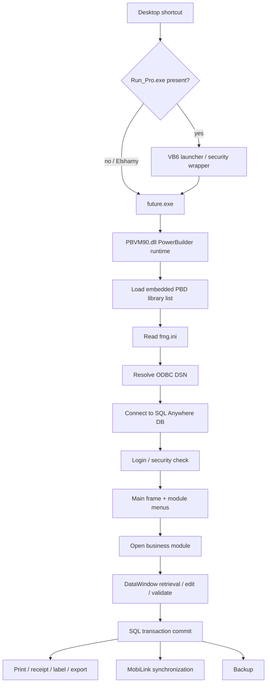
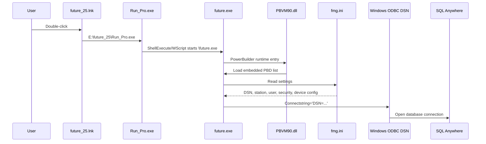
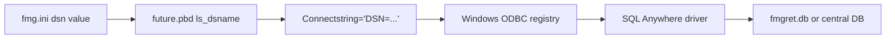
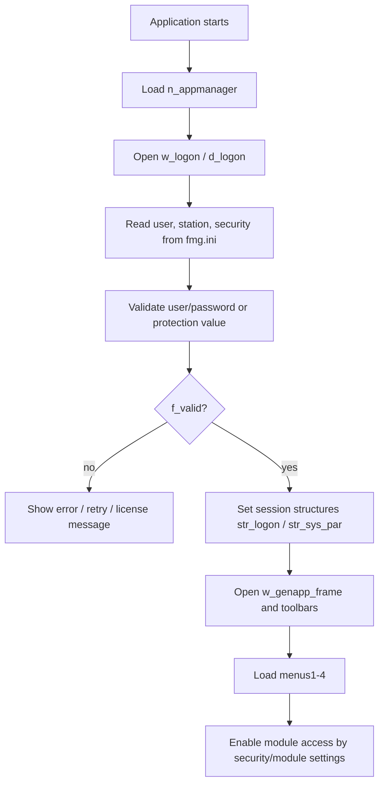
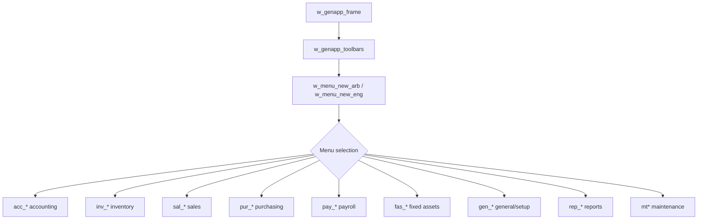
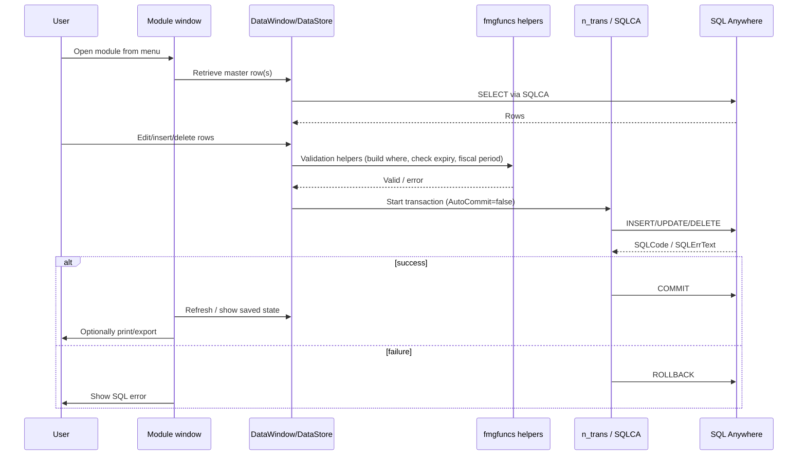
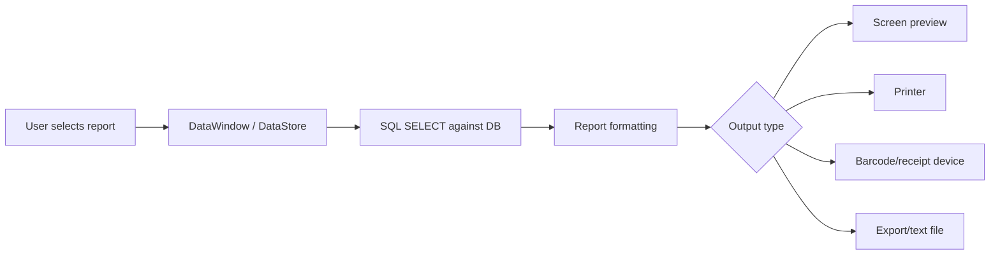
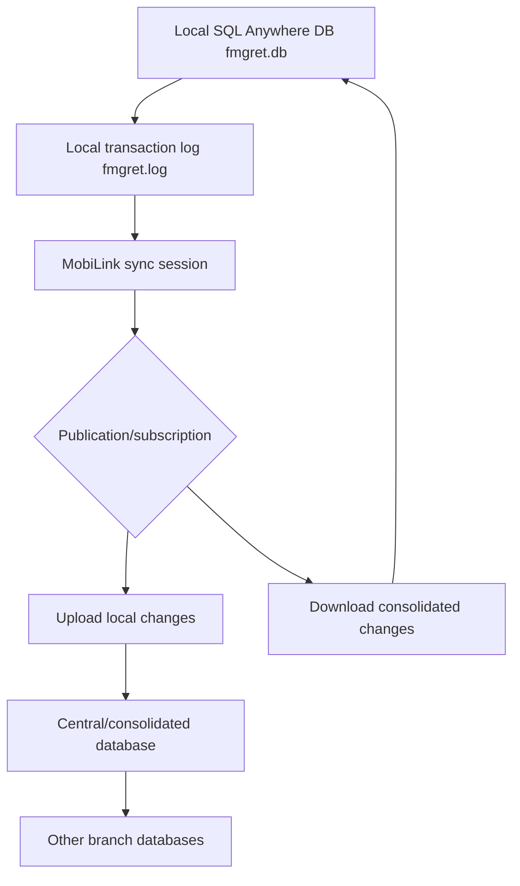
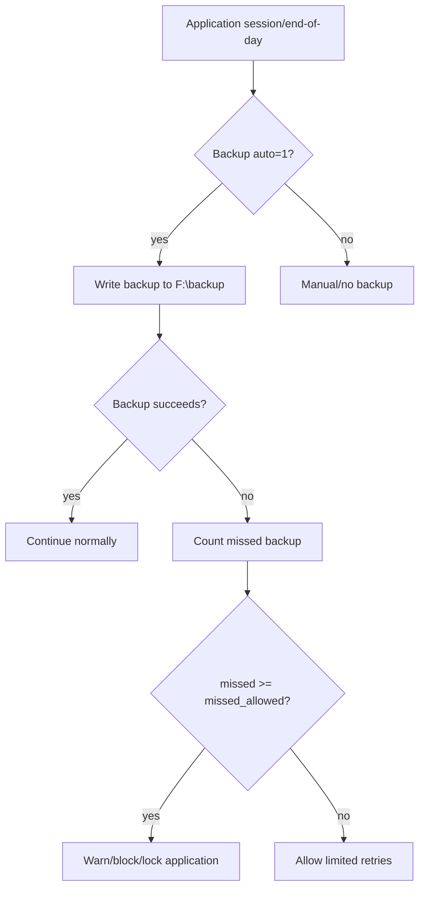

# Future 25 — application workflow

**Date:** 2026-11-25  
**Scope:** static analysis of `D:\future_25 old`, `D:\future_25 - Special`, `D:\future_25`, `D:\Future Elshamy`  
**Constraint:** no executable was launched; no file on `D:` was modified.

## Confidence legend

- **[O]** Observed directly from static artifacts.
- **[I]** Inferred from filenames, object names, config keys, SQL strings, and schema.
- **[U]** Unknown; requires runtime trace, ODBC registry, source/PBD decompilation, or network capture.

---

## 1. High-level workflow



**Summary:** Future 25 is a PowerBuilder 9 desktop ERP/POS application. It starts through a VB6 wrapper in most copies, loads compiled PBD libraries, reads `fmg.ini`, connects through ODBC to SQL Anywhere, presents module menus/windows, performs DataWindow-driven SQL transactions, prints POS/barcode documents, and synchronizes through MobiLink metadata.

---

## 2. Startup workflow

### 2.1 Standard copies

Applies to `D:\future_25 old`, `D:\future_25 - Special`, `D:\future_25`.



Observed details:

- Shortcut target: `E:\future_25\Run_Pro.exe`, working dir `E:\future_25` **[O]**.
- `Run_Pro.exe` is VB6 (`MSVBVM60.DLL`) and contains `ShellExecuteA`, `WScript.Shell`, `\future.exe`, `Future 2010 Security` **[O]**.
- `future.exe` is PE32/x86 and imports `PBVM90.dll` **[O]**.
- `future.exe` embeds 105 `.pbd` references **[O]**.

Inference:

- `Run_Pro.exe` acts as a launcher/security gate before the main PowerBuilder executable **[I]**.
- The exact command line, licensing decision, and failure branch are not statically decoded **[U]**.

### 2.2 Elshamy copy

`D:\Future Elshamy\future25\Future 25.lnk` points directly to `D:\future25\future.exe`, with working directory `D:\future25` **[O]**. This copy also includes the real database files `Data\fmgret.db` and `Data\fmgret.log` **[O]**.

Workflow difference:

```text
Elshamy shortcut -> future.exe -> PBVM90.dll -> PBDs -> fmg.ini -> local/remote SQL Anywhere DB
```

No `Run_Pro.exe` step is observed for this shortcut **[O]**.

---

## 3. Configuration workflow

`fmg.ini` is read after the PowerBuilder runtime starts and before business modules are used **[I]**.

### 3.1 Sections and their workflow role

| Section | Workflow role | Observed examples |
|---|---|---|
| `[database]` | Select DBMS and DSN | `DBMS=ODBC`, `dsn=SPICIAL_HQ` / `dsn=store`, `logid=dba`, `AutoCommit=false` |
| `[Definition]` | Station and protection values | `stationId=101`, obfuscated `handler` |
| `[help]` | External help paths | Word and help document paths |
| `[Current]` | Current user/session defaults | `User=admin`, `security=2`, `Module=1`, barcode/receipt/display flags |
| `[Backup]` | Backup policy | `Path=F:\backup`, `auto=1`, `missed_allowed=3` |
| `[validate]`, `[BarCodePrint]` | Validation and printing | COM port, baud rate, label format, printer model |
| `[CustomerDisplay]`, `[CashDrawer]`, `[ReceiptPrint]` | POS peripherals | display/cash drawer/receipt flags |
| `[CallCenter]`, `[CallerId]` | Call-center integration | COM settings, caller-ID model |
| `[purchaseitems]`, `[SoundPay]`, `[message]` | Module/UI behavior | purchase defaults, sounds/messages |
| `[future]` | Version/protection data | `version=23`, obfuscated `handler23`, `DB23` |

### 3.2 DB connection resolution



- `future.pbd` / `future (2).pbd00` contain `Connectstring='DSN=`, `Bconnect`, and `ls_dsname` **[O]**.
- Actual host/driver is resolved at runtime from the Windows ODBC DSN, not hardcoded as an IP **[I]**.
- DSNs seen: `SPICIAL_HQ`, `store`, commented `future`, commented `rady` **[O]**.
- Commented legacy server: `sengam`, database `fmgret5`, MSS SQL Server **[O]**.
- No IP addresses were found in the scanned artifacts **[O]**.

---

## 4. Login and session workflow

Observed objects in `future.pbd`:

- `w_logon`, `d_logon`, `d_logonold`
- `w_sec`, `w_protect`, `change_pass.fun`
- `of_securety23.fun`, `of_protection.fun`, `of_end_protection.fun`
- `f_encrypte_x.fun`, `f_decrypte_x.fun`, `f_encrypte_x_again.fun`
- `str_logon`, `str_protect`, `str_serial`, `str_sys_par`
- `n_appmanager`, `n_version`, `n_osapi`



Observed support:

- `security=2`, `Module=1`, `User=admin`, `stationId=101` in `fmg.ini` **[O]**.
- B-CONNECT strings include “You have exceeded the number of trials, Please call B-CONNECT” and a local `FutureLicense.exe` path **[O]**.

Inferred:

- User authentication, station validation, and license/protection checks happen before the main frame is usable **[I]**.
- `f_encrypte_x` / `f_decrypte_x` likely support obfuscated config values such as `handler`, `handler23`, and `DB23` **[I]**.
- Exact password rules and license decision logic are unknown **[U]**.

---

## 5. Main application navigation workflow



Observed library families from `D:\future_25`:

| Family | Count | Workflow area |
|---|---:|---|
| `inv` | 28 | Inventory/stores |
| `pay` | 14 | Payroll/HR |
| `acc` | 13 | Accounting |
| `fas` | 12 | Fixed assets |
| `sal` | 8 | Sales |
| `pur` | 7 | Purchasing |
| `gen` | 2 | General/setup |
| `future` | 2 | App shell/login/security |
| `common`, `fmgfuncs`, `fmgances` | 3 | Shared framework |
| `menus1`–`menus4` | 4 | Menus |
| `mt*` / `MMmt*` / `XXmt*` | ~14 | Maintenance/variants |
| `rlcomm`, `tr_data`, `rep_*`, `Y_G1` | 4 | Comms/transactions/reports |

The menu labels themselves were not decoded; module roles are inferred from library names, objects, and SQL **[I]**.

---

## 6. Generic business transaction workflow

Most modules appear to follow a PowerBuilder header/detail pattern using shared base objects from `fmgances.pbd`.

Observed base objects include:

- `w_header_lines`, `w_header_lines_2`
- `uo_dw_master`, `uo_dw_detail`, `uo_dw_header_master`, `uo_dw_header_detail`
- `uo_dw_finder`, `uo_dw_sorter`
- `n_dbasehandle`, `n_trans`
- `w_generic_choice`, `w_base_choice`



Observed support:

- `fmgfuncs.pbd` contains helpers such as `f_build_where`, `f_db_col_names`, `f_fill_db_info`, `f_copy_dw`, `f_company_fiscal_month`, `f_company_fiscal_year`, `f_check_expiry_balance` **[O]**.
- `.pbd` libraries contain frequent `sqlca`, `sqlcode`, `sqlerrtext`, `connectioninfo`, `setsqlselect`, and `getsqlselect` strings **[O]**.
- `AutoCommit=false` means application-managed transactions are expected **[I]**.

---

## 7. Module-level workflows

These are inferred from table names, PBD families, object names, and recovered schema.

### 7.1 Inventory / stores

```text
Open inventory window
  -> retrieve item_master / item_groups / stores / item_company
  -> select transaction type (issue, receipt, transfer, balance)
  -> enter header + lines
  -> check expiry/balance/stock
  -> write issue_trans_header, issue_transaction_items, balance_*
  -> update item/store balances
  -> print label/receipt if enabled
```

Evidence:

- `inv_*` libraries, `d_item_master`, `d_item_groups`, `d_item_company`, `d_item_price` **[O]**.
- Tables: `ITEM_MASTER`, `ITEM_GROUPS`, `STORES`, `ISSUE_TRANS_HEADER`, `ISSUE_TRANSACTION_ITEMS`, `BALANCE_ISSUE`, `BALANCE_RET_ISSUE`, `ITEM_STORE_COMPANY_EXPIRY` **[O]**.
- Helper `f_check_expiry_balance` **[O]**.

### 7.2 Sales

```text
Open sales window
  -> select customer/company/store
  -> retrieve item/price/customer price
  -> build transaction lines
  -> check stock/price/discount
  -> save sales/retail transaction headers and items
  -> print receipt/invoice
```

Evidence:

- `sal_*` libraries and `ratr_*` tables **[O]**.
- Tables: `CUSTOMER`, `CUSTOMER_COMAPNY`, `ITEM_COMPANY_CUSTOMER_PRICE`, `RATR_TRANSACTION_HEADER`, `RATR_TRANSACTION_ITEMS`, `SALES_*` **[O]**.

### 7.3 Purchasing

```text
Open purchase window
  -> select vendor/company/store
  -> retrieve item/vendor price
  -> enter purchase order/receipt lines
  -> save purchase/order tables
  -> update inventory receipts/balances
```

Evidence:

- `pur_*` libraries **[O]**.
- Tables: `VENDOR`, `COMPANY_VENDORS`, `ITEM_COMPANY_VENDOR`, `PURCHASE_*`, `ORDERS_*` **[O]**.

### 7.4 Accounting / GL

```text
Open accounting window
  -> select company/fiscal period/cost center
  -> retrieve chart_of_accounts
  -> enter journal voucher header/detail
  -> validate account/fiscal period
  -> save gl_journal_voucher_detail and related balance tables
```

Evidence:

- `acc_*` libraries **[O]**.
- Tables: `CHART_OF_ACCOUNTS`, `COMPANY_CHART_OF_ACCOUNT`, `GL_JOURNAL_VOUCHER_DETAIL`, `COMPANY_COST_CENTERS`, `SYSTEM_BALANCE` **[O]**.

### 7.5 Payroll / HR

```text
Open payroll/HR window
  -> select company/employee/period
  -> retrieve attendance/allowances/deductions
  -> calculate payslip values
  -> save payslip_monthly_copy and deduction/benefit tables
  -> print payslip/report if enabled
```

Evidence:

- `pay_*` libraries **[O]**.
- Tables: `EMPLOYEE`, `ATTENDANCE`, `ALLOWAN_*`, `PAYSLIP_MONTHLY_COPY`, `BENEFIT`, `LEAVE_*`, `SALARY_*` **[O]**.

### 7.6 Fixed assets

```text
Open fixed-assets window
  -> select company/asset category
  -> retrieve fa/asset records
  -> enter/add asset or depreciation transaction
  -> save fixed-asset tables
  -> post related accounting entries
```

Evidence:

- `fas_*` libraries **[O]**.
- `FA_*`, `FIXED_*`, `DEPREC_*` table families **[O]**.

---

## 8. Reporting and printing workflow



Observed details:

- `common.pbd` contains many label DataWindows, e.g. `ds_laser_label_std6x24_*`, `ds_driver_bar_label*` **[O]**.
- `future.pbd` includes label DataWindows and `ds_opened_sheft` **[O]**.
- `fmg.ini` defines `FormatFile`, label names, COM ports, baud rate, `LazerPrint`, `DosPrint`, `ReceiptPrint`, `BarCodePrint`, `CustomerDisplay`, `CashDrawer` **[O]**.
- `run_scripts.exe` references `rep_branchs.pbd` and `w_run_scripts_support_25.win` **[O]**.

Inference:

- Reports are DataWindow-based, with output to preview/printer/POS devices **[I]**.
- `run_scripts.exe` is a support/report-script runner **[I]**.

---

## 9. Synchronization workflow

Evidence from `fmgret.db` strings and recovered schema:

- SQL Anywhere 9 / Adaptive Server Anywhere **[O]**.
- MobiLink system procedures and tables: `ml_*`, `ml_script_version`, `ml_add_connection_script`, `ml_add_table_script`, `ml_set_device_address`, publications/subscriptions, `sync_id`, `consolidate`, `synchronize` **[O]**.
- `fmgret.log` contains logged DDL and transactions **[O]**.



Unknowns:

- Exact sync server address/protocol **[U]**.
- Which tables are in which publication/subscription **[U]**.
- Sync schedule/trigger mechanism **[U]**.

No URLs, IPs, or MobiLink endpoint strings were found in the scanned artifacts except `http://www.devlib.net` and legacy DSN/server names **[O]**.

---

## 10. Backup workflow

Observed from `fmg.ini`:

```text
[Backup]
Path = F:\backup
auto = 1
missed_allowed = 3
```

Inferred workflow:



Exact warning text and enforcement behavior are unknown **[U]**.

---

## 11. Error and recovery workflow

Observed support:

- `sqlcode`, `sqldbcode`, `sqlerrtext`, `sqlsyntax` strings throughout PBDs **[O]**.
- `w_error`-style and message strings in launcher licensing path **[O]**.
- B-CONNECT trial-limit message **[O]**.
- `fmgret.log` provides recovery/transaction history for the database **[O]**.

Typical inferred flow:

```text
SQL/action fails
  -> SQLCA.sqlcode / sqlerrtext populated
  -> DataWindow or module displays error
  -> transaction rollback
  -> user retries or corrects input
```

License/protection failure flow:

```text
B-CONNECT/license check fails
  -> error message
  -> retry count increases
  -> after limit, application blocks and asks user to call B-CONNECT
```

Exact branches are not decompiled **[U]**.

---

## 12. Variants and workflow differences

| Copy | Workflow difference |
|---|---|
| `future_25 old` | 114 PBDs; `dsn=store`; shortcut via `Run_Pro.exe` |
| `future_25 - Special` | 228 PBDs; `dsn=SPICIAL_HQ`; nested `future_25\fmg.ini` uses `dsn=store`; includes `run_scripts.exe` |
| `future_25` | 114 PBDs; `dsn=store`; shortcut via `Run_Pro.exe` |
| `Future Elshamy` | shortcut directly to `future.exe`; includes real DB/log; all DSNs commented in `fmg.ini` |

Interpretation:

- The three non-Elshamy copies look like deployment variants of the same application with different DSN/configuration **[I]**.
- The Special copy contains a larger library set, likely a superset/customization **[I]**.
- Elshamy appears to be a working/installation copy with data **[O]**.

---

## 13. Supporting files

- Detailed static analysis: `future_25_static_analysis.md`
- Full recovered DB schema: `future25_schema.sql`
- Schema report: `future25_schema_report.md`
- REA Evidence bundle: `future_25_rea_evidence.json`

---

## 14. What is not established

- No runtime trace was captured, so no actual click path, timing, or success/failure branch was observed.
- PBD bytecode was not decompiled; PowerBuilder internals are inferred from names and strings.
- ODBC DSN registry values were not present on this host, so real DB hosts are unknown.
- MobiLink sync endpoint, schedule, and publication membership are unknown.
- License/protection algorithms and decoded `handler`/`DB23` values are unknown.
