# Future 25 — application architecture

**Date:** 2026-11-25  
**Scope:** `D:\future_25 old`, `D:\future_25 - Special`, `D:\future_25`, `D:\Future Elshamy`  
**Safety:** no executable was launched; no file on `D:` was modified.  
**Method:** REA static inspection of PE/shortcut artifacts, read-only PowerBuilder `.pbd` byte/string scans, `fmg.ini` inspection, and recovered SQL Anywhere DDL.

## Confidence legend

- **[O]** Observed directly in a static artifact.
- **[I]** Inferred from names, strings, config, schema, and joins.
- **[U]** Unknown; requires runtime trace, registry/DB access, source, or decompilation.

---

## 1. Architecture at a glance

Future 25 is a **legacy PowerBuilder 9 desktop ERP/POS application** with a shared SQL Anywhere database.

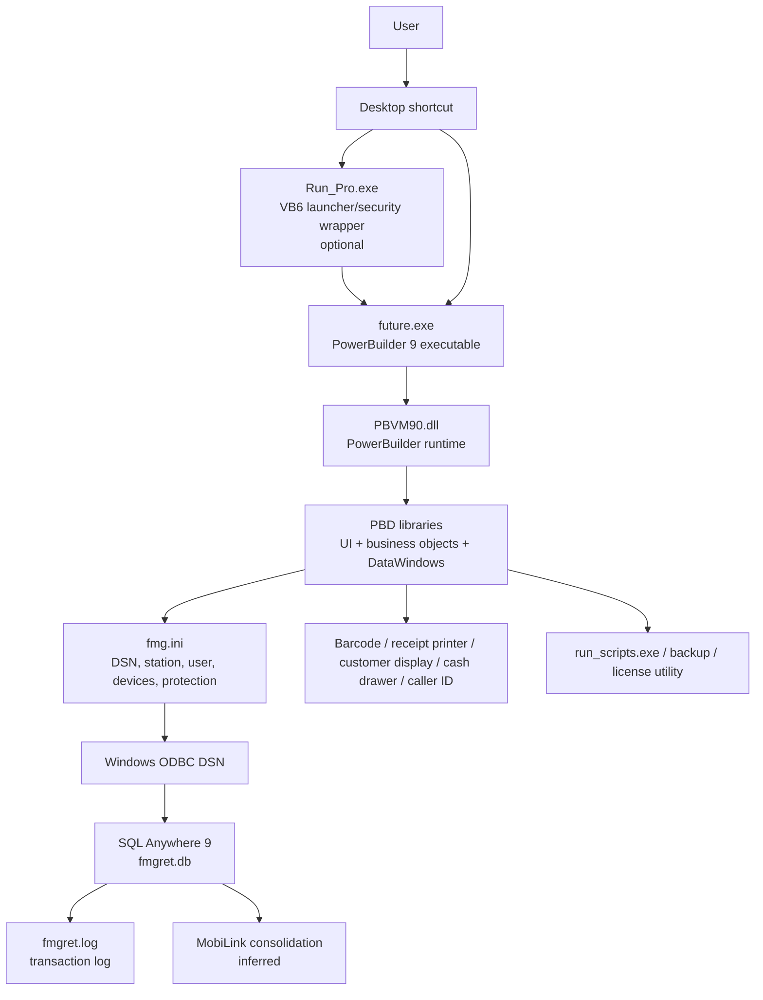

**Architectural style:** monolithic fat-client desktop application with a modular PowerBuilder library set and a centralized/branch SQL Anywhere database. It is **not** a web app, Electron app, or service-oriented system **[O]**.

---

## 2. System context

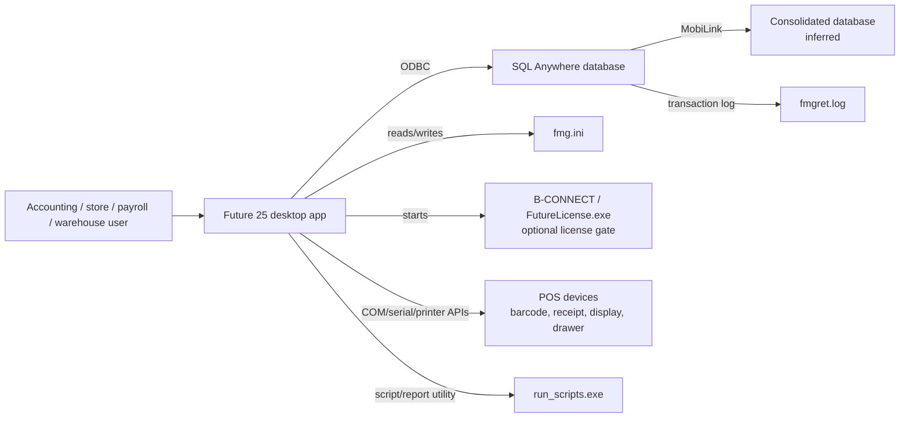

| External entity | Relationship | Status |
|---|---|---|
| User | Operates desktop UI | **[O]** |
| SQL Anywhere DB | Stores all business data | **[O]** |
| Windows ODBC | Resolves DSN to DB driver/host | **[O]** |
| POS devices | Barcode, receipt, customer display, cash drawer | **[O]** config; **[I]** behavior |
| B-CONNECT / FutureLicense.exe | License/protection gate | **[O]** strings/path; **[I]** role |
| MobiLink consolidated DB | Synchronizes branch data | **[I]** from DB metadata |
| `run_scripts.exe` | Support/report-script runner | **[O]** strings; **[I]** role |

---

## 3. Container view

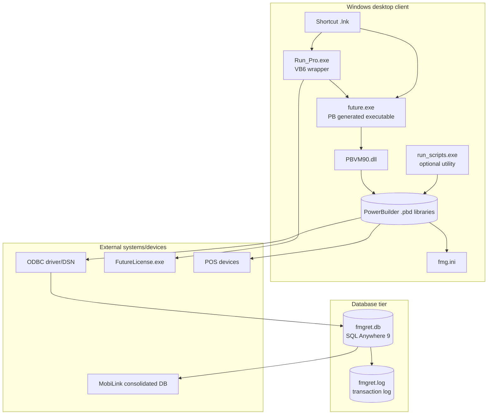

### 3.1 Executables

| Executable | Type | Architecture role | Evidence |
|---|---|---|---|
| `future.exe` | PE32/x86 | Main PowerBuilder application | Imports `PBVM90.dll`; embeds 105 PBD references **[O]** |
| `Run_Pro.exe` | PE32/x86 VB6 | Launcher/security wrapper in three copies | Imports `MSVBVM60.DLL`; strings `\future.exe`, `ShellExecuteA`, `Future 2010 Security` **[O]** |
| `run_scripts.exe` | PE32/x86 PowerBuilder | Support/report-script utility in Special copy | Imports `PBVM90.dll`; references `rep_branchs.pbd`, `w_run_scripts_support_25.win` **[O]** |
| `fashion.exe` | PE32/x86 PowerBuilder | Additional PB executable in Elshamy copy | Imports `PBVM90.dll` **[O]** |

---

## 4. Layered architecture

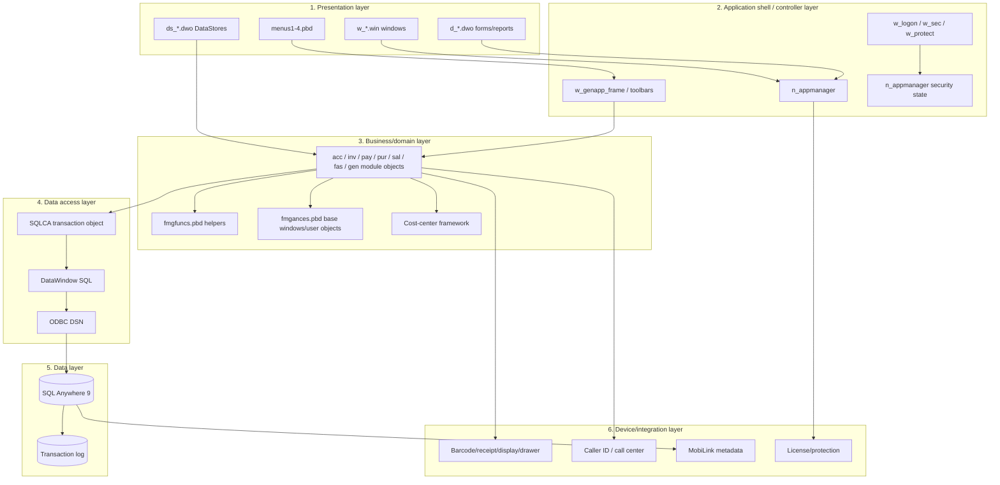

### 4.1 Presentation layer

Observed object families **[O]**:

| Object | Count from `D:\future_25` string scan | Role |
|---|---:|---|
| `w_*.win` | 826 | UI windows |
| `d_*.dwo` / `ds_*.dwo` | 2,925 | DataWindows/DataStores |
| Arabic windows | 405 | `_arb` variants |
| English windows | 327 | `_eng` variants |
| Neutral windows | 94 | language-neutral |

The application ships both Arabic and English screens for many modules; language selection mechanism is unknown **[U]**.

### 4.2 Application shell layer

Core shell objects in `future.pbd` **[O]**:

- `w_logon`, `d_logon`, `d_logonold`
- `w_sec`, `w_protect`, `change_pass.fun`
- `w_genapp_frame`, `w_genapp_frame_arb`, `w_genapp_frame_eng`
- `w_genapp_toolbars*`
- `w_menu_new_arb`, `w_menu_new_eng`
- `n_appmanager`, `n_version`, `n_osapi`
- `str_logon`, `str_sys_par`, `str_protect`, `str_serial`

Inferred shell flow **[I]**:

```text
n_appmanager
  -> login / protection check
  -> set session structures
  -> open w_genapp_frame
  -> open toolbars
  -> load menus1-4
  -> open module window
```

### 4.3 Business/domain layer

PowerBuilder library families from `D:\future_25` **[O]**:

| Family | Libraries | Domain |
|---|---:|---|
| `inv` | 28 | Inventory, stores, item balances, issues/receipts/transfers, expiry, prices |
| `pay` | 14 | Payroll, HR, attendance, allowances/deductions, payslips |
| `acc` | 13 | Accounting, GL, vouchers, chart of accounts, balances, cost centers, budgets |
| `fas` | 12 | Fixed assets, depreciation, asset transfers/cards |
| `sal` | 8 | Sales, retail transactions, customers |
| `pur` | 7 | Purchasing, vendors, purchase orders |
| `gen` | 2 | General setup |
| `future` | 2 | Shell, login, security, protection |
| `common`, `fmgfuncs`, `fmgances` | 3 | Shared DataWindows, helper functions, reusable base objects |
| `menus1`–`menus4` | 4 | Menu libraries |
| `mt*`, `MMmt*`, `XXmt*` | ~14 | Maintenance and variant modules |
| `rlcomm`, `tr_data`, `rep_*`, `Y_G1` | 4 | Communications, transaction data, reports, miscellaneous |

### 4.4 Shared framework

Reusable base objects in `fmgances.pbd` **[O]** include:

- `w_header_lines`, `w_header_lines_2`
- `w_master_detail`, `w_master_detail_tab`
- `w_generic_choice`, `w_base_choice`, `w_generic_choice_search`
- `w_mlevels_*`
- `w_print_generic`, `w_print_shared_dw`
- `uo_dw_master`, `uo_dw_detail`, `uo_dw_header_master`, `uo_dw_header_detail`
- `uo_dw_finder`, `uo_dw_sorter`
- `n_dbasehandle`, `n_trans`

Shared helpers in `fmgfuncs.pbd` **[O]** include:

- `f_build_where`
- `f_db_col_names`
- `f_fill_db_info`
- `f_copy_dw`
- `f_company_fiscal_month`
- `f_company_fiscal_year`
- `f_check_expiry_balance`

Interpretation **[I]**: modules are built around reusable master/detail and DataWindow patterns rather than independent bespoke screens.

### 4.5 Data access layer

Evidence **[O]**:

- PBD strings frequently contain `sqlca`, `sqlcode`, `sqldbcode`, `sqlerrtext`, `sqlsyntax`.
- `fmg.ini` sets `DBMS=ODBC` and `AutoCommit=false`.
- `future.pbd` contains `Connectstring='DSN=` and `ls_dsname`.
- `future.exe` imports `PBVM90.dll`, confirming PowerBuilder DataWindow runtime usage.

Inferred data access pattern **[I]**:

1. `fmg.ini` supplies DSN name.
2. PowerBuilder builds an ODBC connect string.
3. `SQLCA` opens the database transaction.
4. DataWindows/DataStores issue SQL through SQLCA.
5. `AutoCommit=false` means the application explicitly commits or rolls back.
6. Errors are handled through SQLCode/SQLErrText and shown in UI messages.

---

## 5. Startup architecture

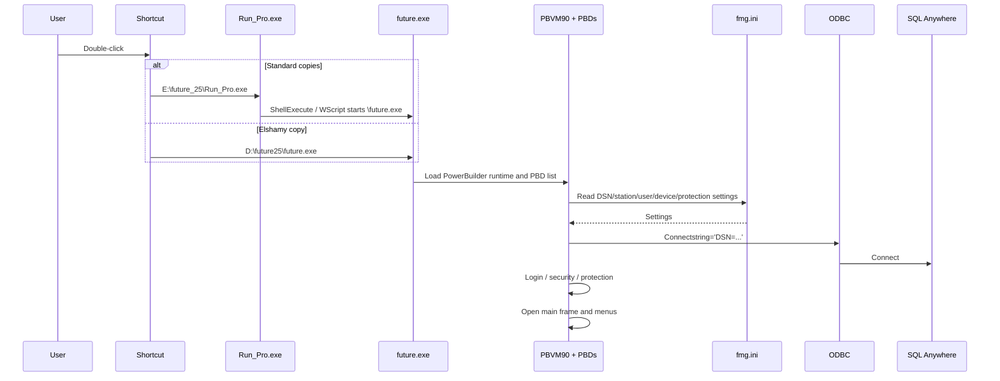

### 5.1 Startup variants

| Copy | Startup chain |
|---|---|
| `future_25 old` | Shortcut → `Run_Pro.exe` → `future.exe` |
| `future_25 - Special` | Shortcut → `Run_Pro.exe` → `future.exe`; also has `run_scripts.exe` |
| `future_25` | Shortcut → `Run_Pro.exe` → `future.exe` |
| `Future Elshamy` | Shortcut → `future.exe` directly |

Evidence: shortcut targets and EXE imports **[O]**.

---

## 6. Deployment architecture

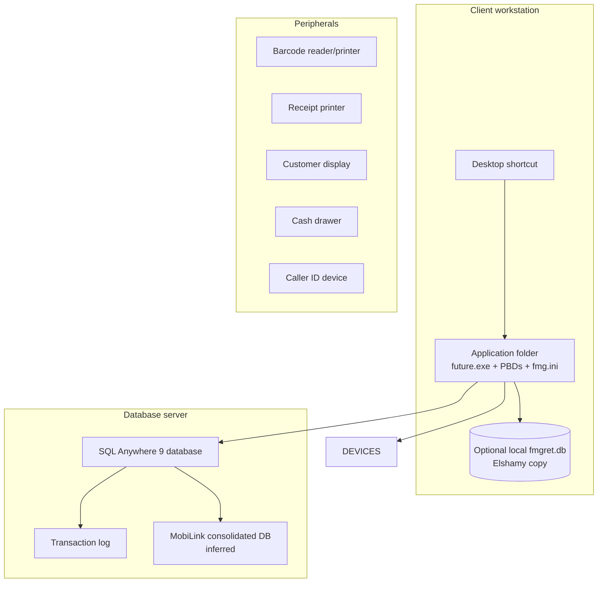

Deployment facts **[O]**:

- Three copies point shortcuts to `E:\future_25\Run_Pro.exe`, even when stored on `D:`.
- Elshamy points to `D:\future25\future.exe`.
- Elshamy includes the real database and log in `D:\Future Elshamy\future25\Data\`.
- Special copy is the largest library set: 268 files / 228 PBDs.

---

## 7. Configuration architecture

`fmg.ini` is the central runtime configuration source **[O]**.

| Section | Architectural role |
|---|---|
| `[database]` | DBMS, DSN, login id, auto-commit |
| `[Definition]` | Station and protection/handler values |
| `[Current]` | Current user, security level, module, display flags |
| `[Backup]` | Backup path, auto flag, missed-backup allowance |
| `[validate]` | Validation behavior |
| `[BarCodePrint]` | Barcode label/printing configuration |
| `[CustomerDisplay]` | Customer display flags/port |
| `[CashDrawer]` | Cash drawer flags/port |
| `[ReceiptPrint]` | Receipt printer settings |
| `[purchaseitems]` | Purchasing defaults |
| `[SoundPay]`, `[message]` | UI sounds/messages |
| `[CallCenter]`, `[CallerId]` | Call-center/caller-ID integration |
| `[future]` | Version and obfuscated protection values |

Important values **[O]**:

- `DBMS=ODBC`
- `dsn=SPICIAL_HQ` in Special root config
- `dsn=store` in old/plain/nested Special config
- `logid=dba`
- `LogPassWord` empty/commented
- `AutoCommit=false`
- `stationId=101`, `User=admin`, `security=2`, `Module=1`
- `[Backup] Path=F:\backup`, `auto=1`, `missed_allowed=3`

The real DB host is resolved through Windows ODBC, not hardcoded as an IP **[O]/[I]**.

---

## 8. Data architecture

### 8.1 Database engine

`D:\Future Elshamy\future25\Data\fmgret.db` is a **SQL Anywhere 9 / Adaptive Server Anywhere 9.0.2.2451** database **[O]**.

Evidence:

- REA SQLite inspection rejected it as “not a database” for SQLite.
- Embedded strings identify Sybase/iAnywhere SQL Anywhere.
- Companion `fmgret.log` is a SQL Anywhere transaction log.
- MobiLink system objects are present.

### 8.2 Logical data domains

The recovered schema contains 321 tables, 475 foreign-key/constraint statements, 36 indexes, and 1 view **[O]**.

| Domain | Example tables |
|---|---|
| Organization/setup | `COMPANY`, `STORES`, `COMPANY_STORES`, `CURRENCY`, `USER_COMPANY_STORE` |
| Items/pricing | `ITEM_MASTER`, `ITEM_GROUPS`, `ITEM_COMPANY`, `ITEM_STORE_COMPANY`, price tables |
| Accounting/GL | `CHART_OF_ACCOUNTS`, `COMPANY_CHART_OF_ACCOUNT`, `GL_JOURNAL_VOUCHER_HEADER`, `GL_JOURNAL_VOUCHER_DETAIL` |
| Cost control | `COST_CENTERS`, `COMPANY_COST_CENTERS`, `GL_COST_CENTER_DETAIL`, `GL_COST_CENTER_SUMMERY`, `GL_BUDGET` |
| Inventory transactions | `ISSUE_TRANS_HEADER`, `ISSUE_TRANSACTION_ITEMS`, `BALANCE_*`, `SYSTEM_BALANCE` |
| Sales/retail | `RATR_TRANSACTION_HEADER`, `RATR_TRANSACTION_ITEMS`, `RATR_TRANSACTION_HEADER_COST` |
| Purchasing | `VENDOR`, `PURCHASE_ORDER_HEADER`, vendor/item tables |
| Payroll/HR | `EMPLOYEE`, `ATTENDANCE`, `TIME_SHEET_TRANSACTION`, `PAYSLIP_MONTHLY_COPY` |
| Fixed assets | `fa_asset_card`, `fa_asset_trans_detail`, `fa_dep_journal_voucher_detail` |
| Job order/costing | `CST_JOB_ORDER_HEADER`, `CST_JOB_ORDER_DETAIL` |
| PowerBuilder support | `pbcatcol`, `pbcatfmt`, `pbcatedt`, `pbcatvld`, `DW_SPECS`, `CHOICE_*` |
| MobiLink/UltraLite | `ml_*`, `ul_*`, publications/subscriptions |

Full DDL: `future25_schema.sql`.

### 8.3 Transaction boundaries

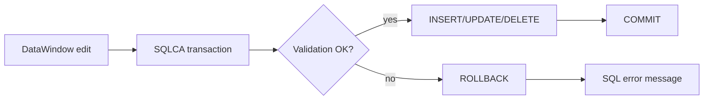

`AutoCommit=false` **[O]** implies explicit application-managed transactions **[I]**.

---

## 9. Business workflow architecture

Generic module pattern **[I]**, based on shared base objects and table structures:

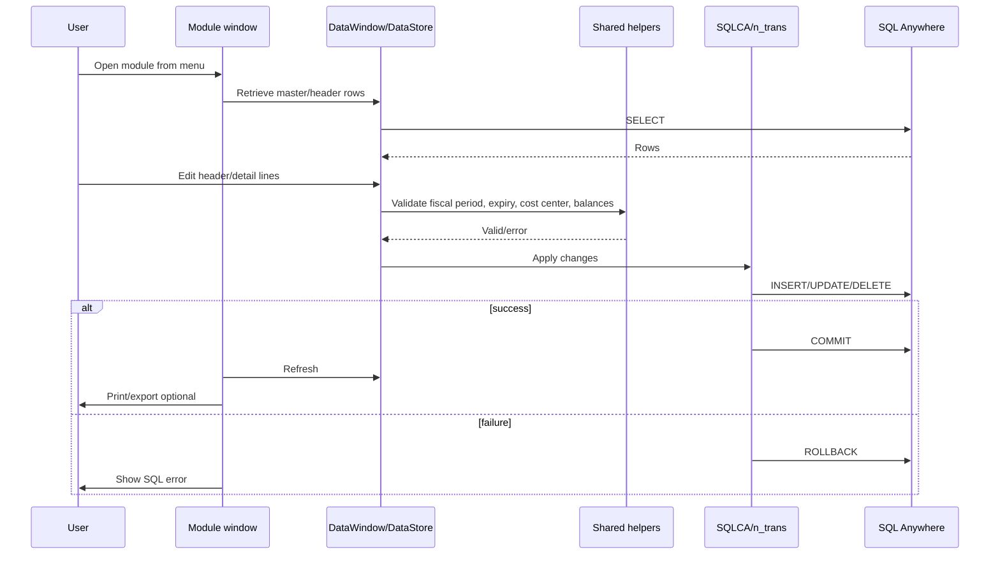

### 9.1 Major domain flows

| Domain | Flow summary | Evidence |
|---|---|---|
| Inventory | item/store setup → issue/receipt/transfer → balance tables → cost/balance reports | PBD names, tables, helpers **[O]** |
| Sales | customer/store/item → retail transaction header/items → cost distribution → receipt/invoice | `sal_*`, `ratr_*` **[O]** |
| Purchasing | vendor/company/item → PO header/lines → expenses/tax/transport → receipt/balance update | `pur_*`, `PURCHASE_ORDER_HEADER` **[O]** |
| Accounting | company/account/period → voucher header/detail → cost-center distribution → trial balance | `acc_*`, GL tables **[O]** |
| Payroll | employee/attendance → salary calculation → payroll posting → payslip/report | `pay_*`, payroll tables **[O]** |
| Fixed assets | asset card/class → acquisition/transfer/depreciation → depreciation JV → reports | `fas_*`, FA tables **[O]** |
| Cost control | cost-center tree → assignments → tagged transactions → GL rollup → budget/report | dedicated cost doc **[O]/[I]** |

---

## 10. Reporting and output architecture

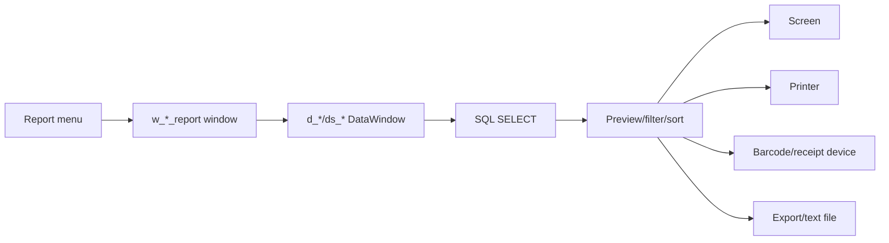

Observed output infrastructure **[O]**:

- Many `w_*_report_arb/eng.win` windows.
- Reusable print windows: `w_print_generic`, `w_print_shared_dw`, `w_print_any`.
- Label DataWindows in `common.pbd` and `future.pbd`.
- `fmg.ini` sections for barcode, receipt, customer display, cash drawer.
- `run_scripts.exe` references `rep_branchs.pbd` and `w_run_scripts_support_25.win`.

Inference **[I]**: reporting is DataWindow-centric and device output is configured externally through `fmg.ini`.

---

## 11. Synchronization architecture

Evidence from `fmgret.db` strings and recovered DDL **[O]**:

- MobiLink system procedures/tables: `ml_*`.
- `ml_script_version`, `ml_add_connection_script`, `ml_add_table_script`, `ml_set_device_address`.
- Publications, subscriptions, `sync_id`, `consolidate`, `synchronize`.

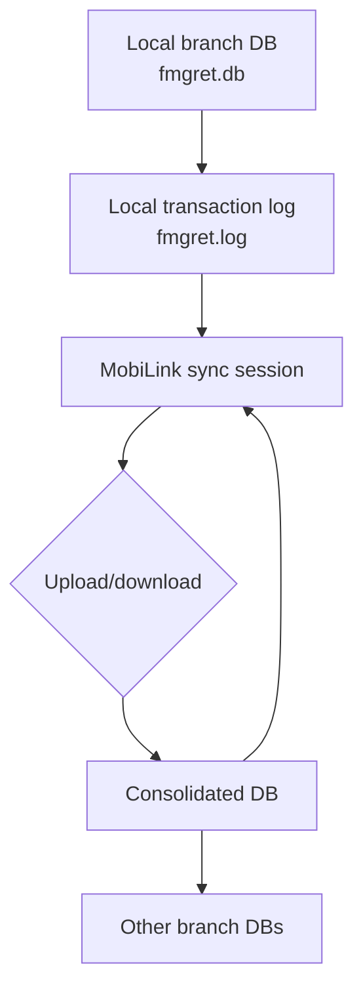

Unknown **[U]**: sync endpoint, protocol, schedule, publication membership, and whether a separate sync executable is installed.

---

## 12. Security and protection architecture

Observed elements **[O]**:

- Login/security windows: `w_logon`, `w_sec`, `w_protect`.
- Protection functions: `of_securety23.fun`, `of_protection.fun`, `of_end_protection.fun`.
- Encryption helpers: `f_encrypte_x.fun`, `f_decrypte_x.fun`, `f_encrypte_x_again.fun`.
- State structures: `str_logon`, `str_protect`, `str_serial`, `str_sys_par`.
- B-CONNECT strings and path `C:\Program Files\B-connect\Future license\FutureLicense.exe`.
- Trial-limit message: “You have exceeded the number of trials, Please call B-CONNECT”.
- `fmg.ini` obfuscated values: `handler`, `handler23`, `DB23`.
- `key.txt` contains key-like strings.

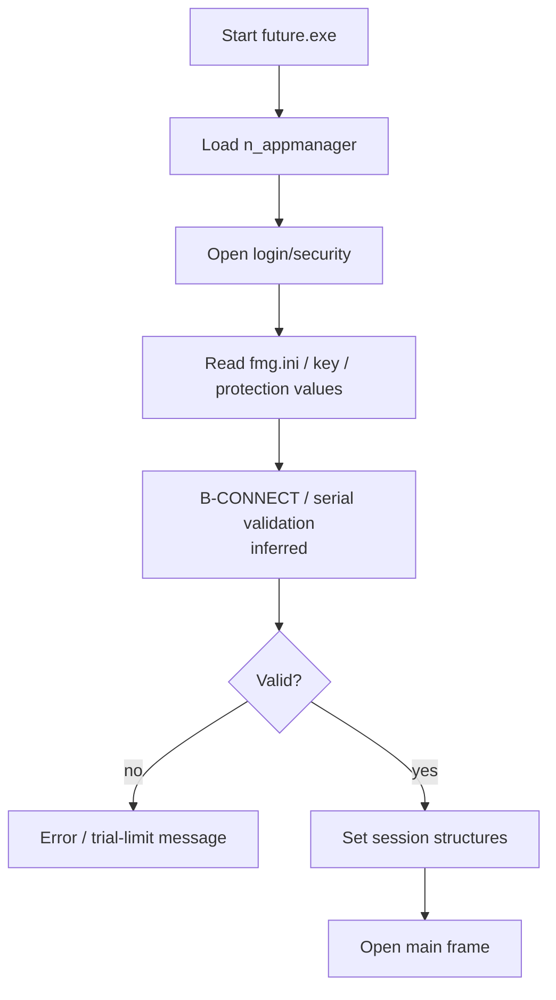

Unknown **[U]**: exact license algorithm, password rules, and protection decision branches. PBD bytecode was not decompiled.

---

## 13. Backup and recovery architecture

Observed config **[O]**:

```text
[Backup]
Path = F:\backup
auto = 1
missed_allowed = 3
```

Inferred design **[I]**:

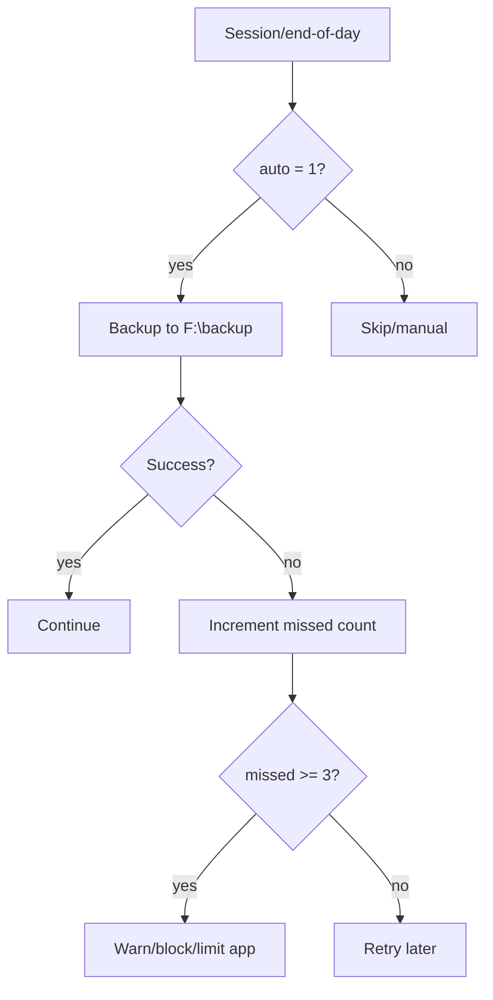

Database recovery evidence **[O]**:

- `fmgret.log` is a SQL Anywhere transaction log.
- Schema was recoverable from the log via `dbtran`.
- No live DB data query was performed.

---

## 14. Cross-cutting concerns

| Concern | Implementation | Status |
|---|---|---|
| Localization | `_arb` and `_eng` window variants | **[O]** |
| Audit trail | `SEC_INSERT_UID`, `SEC_UPDATE_UID`, date columns across tables | **[O]** |
| Explicit transactions | `AutoCommit=false`, `SQLCA`/`n_trans` | **[O]/[I]** |
| Error reporting | `sqlcode`, `sqldbcode`, `sqlerrtext`, UI messages | **[O]** |
| Reusability | `fmgances.pbd`, `fmgfuncs.pbd`, `common.pbd` | **[O]** |
| Cost control | cost-center tables, GL rollups, budget tables | **[O]/[I]** |
| Device integration | COM ports, baud rate, printer/label settings | **[O]** |
| Backup | `fmg.ini` backup section | **[O]** |
| Synchronization | MobiLink metadata | **[O]** |
| Protection/licensing | B-CONNECT strings and encryption helpers | **[O]/[I]** |

---

## 15. Architecture by deployment copy

| Copy | Architectural differences |
|---|---|
| `future_25 old` | 134 files / 114 PBDs; `dsn=store`; shortcut via `Run_Pro.exe` |
| `future_25 - Special` | 268 files / 228 PBDs; `dsn=SPICIAL_HQ`; nested config uses `dsn=store`; includes `run_scripts.exe`; largest/customized deployment |
| `future_25` | 134 files / 114 PBDs; `dsn=store`; shortcut via `Run_Pro.exe` |
| `Future Elshamy` | 145 files / 117 PBDs; shortcut directly to `future.exe`; includes `fmgret.db` and `fmgret.log`; all DSNs commented in config |

Interpretation **[I]**:

- old/plain are likely standard branch deployments.
- Special is a superset/customized deployment.
- Elshamy is the only copy with actual data and a direct launch path.

---

## 16. Architectural constraints and risks

| Constraint/risk | Evidence |
|---|---|
| Legacy x86 Windows binary | All main EXEs are PE32/x86 **[O]** |
| Dependency on old PowerBuilder runtime | `PBVM90.dll` imports **[O]** |
| Dependency on ODBC DSN configuration | `fmg.ini` + embedded DSN strings **[O]** |
| No source code available | only compiled PBDs **[O]** |
| PBD bytecode not decompiled | native REA engines unavailable **[O]** |
| Central DB/DSN host unknown | DSN definitions not present on this host **[U]** |
| Hardware/peripheral behavior not proven | only config/strings observed **[O]/[U]** |
| License gate behavior not proven | strings/path only **[O]/[U]** |
| MobiLink endpoint/schedule unknown | metadata present; no network capture **[O]/[U]** |

---

## 17. Evidence index

Selected REA evidence IDs retained in `future_25_rea_evidence.json`:

| Evidence | ID |
|---|---|
| Special `future.exe` resources | `ev_a7255d987497dd1e7b1a9cc5022f966b5841cc2a8b1e09d504d1281381384008` |
| Special `future.exe` imports | `ev_8deee6cc27431f17b096b8888043ffc25c73d155c254aab84dabf44f324dc5b4` |
| Special `future.exe` fuse check | `ev_7780780b5af605d314cc5acf4c69cb48f0af4ce9dc048abaf6c9b21651aa04e2` |
| Special `Run_Pro.exe` imports | `ev_9a7c6be59a8ef2280cfb3ca5fe16a6a88d63137d33f3a3cdda5016f33086d47f` |
| Shortcut target evidence | `ev_0e26a8592ef9ab98dda4def16324219023e1323fc58fc7be568407a71e58bc90` |
| Release exposure audit | `ev_ea436b6e52f5bea38392672bbe4a29031eebb54104d7d03ec85122614eb6c116` |

---

## 18. What this architecture does not establish

- No runtime process trace was captured.
- No actual click path, menu order, or SQL execution sequence was observed.
- PBD bytecode was not decompiled; business rules are inferred from names, strings, joins, and schema.
- ODBC DSN definitions were not found on this host, so real server names/hosts are unknown.
- MobiLink endpoint, sync schedule, and publication membership are unknown.
- License/protection algorithms were not decoded.
- Device operations were not observed; only configuration and supporting strings were found.

---

## 19. Related documents

- Static analysis: `future_25_static_analysis.md`
- Workflow: `future_25_app_workflow.md`
- UI map: `future_25_app_ui.md`
- Cost-control focus: `future_25_cost_control.md`
- Full recovered schema: `future25_schema.sql`
- Schema report: `future25_schema_report.md`
- REA evidence bundle: `future_25_rea_evidence.json`

---

## 20. Bottom line

Future 25 is a **modular monolithic PowerBuilder 9 desktop ERP/POS system**. Its architecture consists of:

- a VB6 launcher in most deployments,
- `future.exe` hosting the PowerBuilder runtime,
- a large PBD library set containing UI, domain logic, DataWindows, and shared frameworks,
- `fmg.ini` driving DSN, station, user, device, backup, and protection settings,
- ODBC access to a SQL Anywhere database,
- explicit transaction handling through PowerBuilder SQLCA,
- DataWindow-driven forms/reports,
- cost-center and budget logic embedded across accounting/inventory/payroll/assets,
- POS peripheral integrations through configuration,
- MobiLink metadata for branch synchronization.

The design is highly centralized around the database and configuration file, with most business logic compiled into PowerBuilder libraries on the client.
