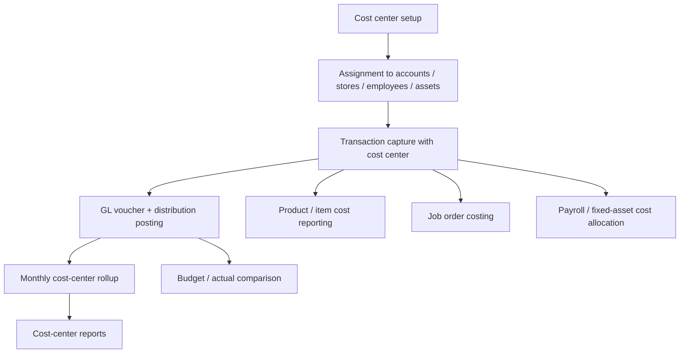
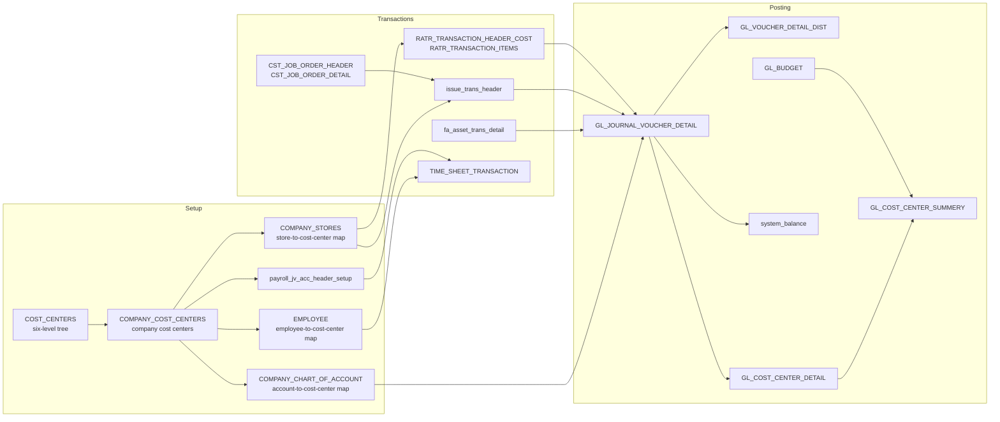
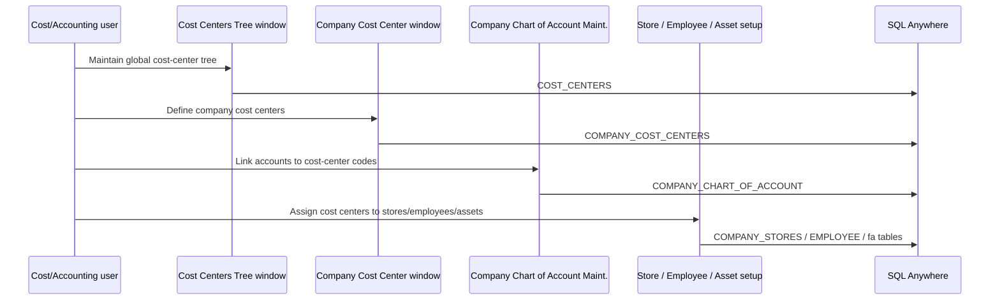
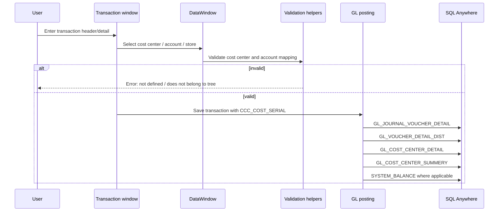
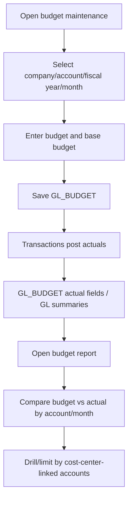
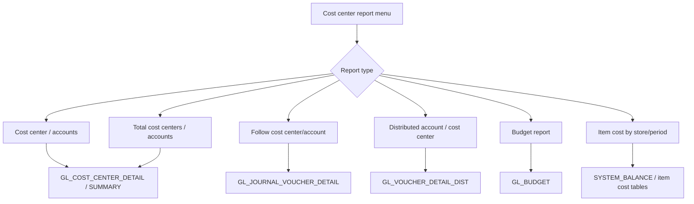
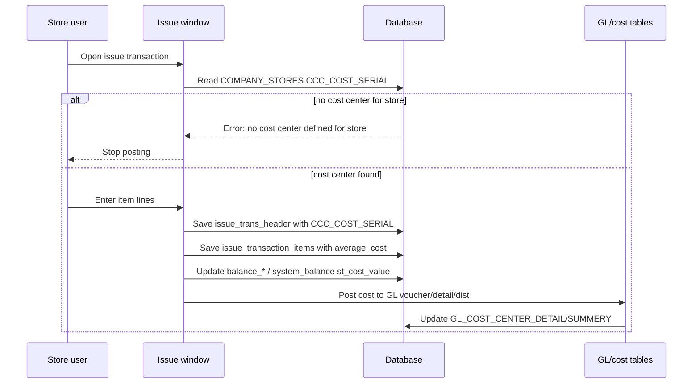

# Future 25 — cost control focus

**Date:** 2026-11-25  
**Scope:** static analysis of `D:\future_25`, with cross-checks in `D:\future_25 - Special`, `D:\future_25 old`, and `D:\Future Elshamy`  
**Constraint:** no executable was launched; no file on `D:` was modified.  
**Evidence sources:** PowerBuilder `.pbd` libraries, `fmg.ini`, recovered SQL Anywhere DDL in `future25_schema.sql`, and the transaction-log translation used to recover it.

## Confidence legend

- **[O]** Observed directly in a static artifact.
- **[I]** Inferred from object names, joins, labels, error messages, and schema.
- **[U]** Unknown; requires runtime trace, source/PBD decompilation, or database data.

---

## Executive summary

Future 25 does not expose one single module named “Cost Control”. Instead, cost control is implemented as a **cross-module cost-center and costing framework** spanning accounting, inventory, purchasing, payroll, fixed assets, and budgeting.

The core of the framework is:

1. A six-level **cost center tree** (`COST_CENTERS`) **[O]**.
2. Company-specific **cost centers** (`COMPANY_COST_CENTERS`) mapped to that tree **[O]**.
3. Cost-center assignment on:
   - chart of accounts (`COMPANY_CHART_OF_ACCOUNT`) **[O]**,
   - stores (`COMPANY_STORES`) **[O]**,
   - employees (`EMPLOYEE`) **[O]**,
   - payroll posting setup (`payroll_jv_acc_header_setup`) **[O]**,
   - time sheets (`TIME_SHEET_TRANSACTION`) **[O]**,
   - fixed-asset transactions (`fa_asset_trans_detail`) **[O]**,
   - inventory issues (`issue_trans_header`) **[O]**,
   - job orders (`CST_JOB_ORDER_HEADER` / `CST_JOB_ORDER_DETAIL`) **[O]**.
4. Posting into `GL_JOURNAL_VOUCHER_DETAIL`, with distribution detail in `GL_VOUCHER_DETAIL_DIST` **[O]**.
5. Monthly aggregation into `GL_COST_CENTER_DETAIL` and `GL_COST_CENTER_SUMMERY` **[O]**.
6. Budget-versus-actual tracking in `GL_BUDGET` **[O]**.
7. A large set of cost-center and cost reports in `acc_*`, `fas_*`, `inv_*`, `pay_*`, and `menus*` libraries **[O]**.

In simple terms: **the app captures costs at the point of transaction, tags them to a cost center/account/store/employee/asset, posts them to GL, rolls them up monthly, and reports them against cost centers and budgets.**

---

## 1. Scope and method

### 1.1 Artifacts examined

| Artifact | Role in this analysis |
|---|---|
| `D:\future_25\*.pbd` | Main PowerBuilder UI/business library set used for object and string inventory |
| `D:\future_25\fmg.ini` | Configuration; no cost-specific keys found **[O]** |
| `future25_schema.sql` | Recovered SQL Anywhere DDL used for data model |
| `future25_schema_report.md` | Table/group overview |
| `future_25_app_workflow.md` | General application workflow |
| `future_25_app_ui.md` | General UI object inventory |

### 1.2 Method

- PBD files were read as static bytes and searched for:
  - object names ending in `.win`, `.dwo`, `.udo`, `.fun`, `.str`,
  - embedded DataWindow SQL fragments,
  - menu/report labels,
  - validation and error messages.
- The recovered DDL was searched for cost, budget, cost-center, balance, voucher, journal, store, employee, asset, and product-cost columns.
- No database login was available, so this is **schema and static-code evidence**, not a live data query.

---

## 2. What “cost control” means in this application

Based on the observed objects and tables, cost control has five layers.



| Layer | Purpose | Evidence |
|---|---|---|
| Setup | Define and maintain the cost-center structure | `COST_CENTERS`, `COMPANY_COST_CENTERS`, `w_maint_ml_cost_centers_*`, `w_mdt_comp_cost_center_*` **[O]** |
| Assignment | Decide where costs are allowed to be charged | `CCC_COST_SERIAL` on accounts, stores, employees, assets, issues, payroll setup **[O]** |
| Capture | Enter the cost center during transactions | Error messages such as “You must choose a cost center” and “There is no Cost Center defined for this store” **[O]** |
| Posting | Store cost-center impact in GL records | `GL_JOURNAL_VOUCHER_DETAIL.CCC_COST_SERIAL`, `RIGHT_CCC_COST_SERIAL`, `GL_VOUCHER_DETAIL_DIST` **[O]** |
| Monitoring | Roll up and report costs | `GL_COST_CENTER_DETAIL`, `GL_COST_CENTER_SUMMERY`, `GL_BUDGET`, report windows **[O]** |

---

## 3. Architecture overview



---

## 4. Cost-center master data model

### 4.1 `DBA.COST_CENTERS` — global six-level tree

Observed columns include six hierarchy levels and six parent levels **[O]**.

| Column group | Columns | Meaning |
|---|---|---|
| Code levels | `COC_CODE_L1` … `COC_CODE_L6` | Six-level cost-center code |
| Parent levels | `COC_PARENT_CODE_L1` … `COC_PARENT_CODE_L6` | Parent membership in the tree |
| Names | `MLV_NAME_L1`, `MLV_NAME_L2` | Display names |
| Tree behavior | `MLV_CHILDREN`, `MLV_USER_CODE`, `MLV_REMARKS` | Children flag, user code, remarks |
| Status/audit | `USED_FLAG`, `SEC_INSERT_UID`, `SEC_INSERT_DATE`, `SEC_UPDATE_UID`, `SEC_UPDATE_DATE` | Status and audit trail |
| Primary key | `COC_CODE_L1` … `COC_CODE_L6` | Full six-part key |

Interpretation **[I]**:

- This is the **template/tree** of cost centers.
- The multi-level design supports department/project/branch-style hierarchies.
- The `*_PARENT_CODE_*` columns allow rollup to parent levels.
- `MLV_CHILDREN` likely indicates whether a node has child nodes.

Related UI **[O]**:

| Object | Library | Role |
|---|---|---|
| `w_maint_ml_cost_centers_arb.win` | `gen_s1.pbd` | Arabic maintenance window |
| `w_maint_ml_cost_centers_eng.win` | `gen_s1.pbd` | English maintenance window |
| `w_maint_ml_cost_centers_pay_arb.win` | `gen_s1.pbd` | Payroll-oriented variant |
| `w_maint_ml_cost_centers_pay_eng.win` | `gen_s1.pbd` | Payroll-oriented variant |
| `d_ml_cost_centers_arb.dwo` / `_eng.dwo` / `d_ml_cost_centers_par.dwo` | `gen_s1.pbd` | DataWindow layouts |

Menu/report label **[O]**: `Cost Centers`, `Cost Centers Tree`.

---

### 4.2 `DBA.COMPANY_COST_CENTERS` — company-level cost centers

Observed key fields **[O]**:

- `COM_CODE`
- `CCC_COST_SERIAL`
- `CCC_COST_CODE`
- `CCC_NAME1`, `CCC_NAME2`
- `CCC_CASH_IN`, `CCC_CASH_OUT`
- `CCC_REMARKS`
- `USED_FLAG`
- `MLV_CODE_L1` … `MLV_CODE_L6`

Interpretation **[I]**:

- Each company defines its own cost-center list.
- Each company cost center maps to the global six-level tree via `MLV_CODE_L1` … `MLV_CODE_L6`.
- `CCC_COST_SERIAL` is the internal key used throughout the application.
- `CCC_CASH_IN` / `CCC_CASH_OUT` suggest cash-flow or cash-account linkage at the cost-center level.

Related UI **[O]**:

| Object | Library | Role |
|---|---|---|
| `w_mdt_comp_cost_center_arb.win` / `_eng.win` | `acc_s2.pbd` | Company cost-center maintenance |
| `w_mdt_comp_cost_center_pay_arb.win` / `_eng.win` | `acc_s2.pbd` | Payroll-specific maintenance |
| `d_comp_cost_center_master_arb.dwo` / `_eng.dwo` | `acc_s2.pbd` | Master form |
| `d_comp_cost_center_detail_arb.dwo` / `_eng.dwo` | `acc_s2.pbd` | Detail form |
| `d_comp_cost_centers_list_arb.dwo` / `_eng.dwo` | `acc_s2.pbd` | List DataWindow |
| `d_comp_cost_centers_select_arb.dwo` / `_eng.dwo` | `acc_s2.pbd` | Selection DataWindow |
| `ds_comp_cost_centers.dwo` | `acc_s2.pbd` | DataStore |
| `ds_companycostcenter.dwo` | `acc_t1.pbd` | Transaction-side cost-center lookup |

Menu/report labels **[O]**: `Company Cost Centers`, `Company Cost Center`, `Cost Center Tree`.

---

### 4.3 Account-to-cost-center mapping

`DBA.COMPANY_CHART_OF_ACCOUNT` contains both account classification and cost-center mapping **[O]**.

Cost-related columns:

| Column | Meaning |
|---|---|
| `CCC_COST_SERIAL` | Cost center assigned to this company account |
| `COST_CODE_L1` … `COST_CODE_L6` | Cost tree code copied onto the account |
| `CMPCHRT_MAIN_SUB_COST` | Main/sub cost-center type flag **[I]** |

Static validation message **[O]**:

> `Cost center type is not defined for this account, Please define it using the 'Company Chart of Account Maint.' Program`

Interpretation **[I]**:

- The system expects each GL account to have a defined cost-center treatment.
- Journal posting uses the account’s cost-center definition to validate or derive the cost center.
- The `MAIN_SUB_COST` flag likely distinguishes main cost centers from sub-cost centers.

Related objects **[O]**:

- `d_comp_cost_center_detail_*`
- `d_comp_cost_center_master_*`
- `w_mdt_comp_cost_center_*`
- `acc_s1.pbd`, `acc_s2.pbd`, `acc_g1.pbd`, `acc_t1.pbd` DataWindow SQL references to `company_chart_of_account.cost_code_l1..l6` and `cmpchrt_main_sub_cost`.

---

## 5. Cost-center assignment points

| Assignment point | Table / column | Evidence | Meaning |
|---|---|---|---|
| Company account | `COMPANY_CHART_OF_ACCOUNT.CCC_COST_SERIAL` | **[O]** | GL accounts can be tied to a cost center |
| Store | `COMPANY_STORES.CCC_COST_SERIAL` | **[O]** | Inventory/store transactions inherit a cost center |
| Employee | `EMPLOYEE.CCC_COST_SERIAL` | **[O]** | Payroll labor charged to a cost center |
| Payroll JV setup | `payroll_jv_acc_header_setup.CCC_COST_SERIAL`, `PJVHS_COST_CENTER_FLAG` | **[O]** | Payroll posting lines can use or require cost centers |
| Time sheet | `TIME_SHEET_TRANSACTION.COC_CODE_L1..L6` | **[O]** | Time booked directly against the cost-center tree |
| Fixed asset transaction | `fa_asset_trans_detail.CCC_COST_SERIAL`, `FA_FROM_LAST_COST_SERIAL` | **[O]** | Asset cost/depreciation posted to cost centers, including transfer from old cost center |
| Fixed-asset depreciation JV | `fa_dep_journal_voucher_detail.CCC_COST_SERIAL`, `RIGHT_CCC_COST_SERIAL` | **[O]** | Depreciation posting has debit and credit cost centers |
| Inventory issue | `issue_trans_header.CCC_COST_SERIAL`, `JOB_ORDER_FISCAL_YEAR` | **[O]** | Stock issues tagged to a cost center/job order |
| Sales/retail transaction cost | `RATR_TRANSACTION_HEADER_COST.COST_VALUE`, `COST_PERCENT`, `MTGL_ACCOUNT_SERIAL` | **[O]** | Cost distributed by transaction and GL account |
| Purchase order | `PURCHASE_ORDER_HEADER.PO_TOTAL_EXPENSES`, `PO_TOTAL_TRANSPORTATION` | **[O]** | Landed-cost components captured at PO level |
| Job order | `CST_JOB_ORDER_HEADER`, `CST_JOB_ORDER_DETAIL` | **[O]** | Item/labor/other cost captured by job |

---

## 6. Setup workflow



Observed setup UI families **[O]**:

| Area | Libraries |
|---|---|
| Global/ML cost-center tree | `gen_s1.pbd` |
| Company cost centers | `acc_s2.pbd` |
| Payroll variants | `acc_s2.pbd`, `gen_s1.pbd`, `pay_*` |
| Fixed-asset cost-center lookup | `fas_g1.pbd`, `fas_s1.pbd`, `fas_t1.pbd` |
| Inventory/store cost-center lookup | `inv_s3.pbd`, `inv_t5.pbd`, `mtacc.pbd`, `mtinv.pbd` |

Inferred setup rules **[I]**:

1. Define the global tree first.
2. Define company cost centers that map to the tree.
3. Link accounts to cost-center codes.
4. Assign cost centers to stores, employees, and assets.
5. Only then can transactions validate successfully.

---

## 7. Transaction posting workflow

### 7.1 Generic cost-center posting



### 7.2 GL voucher cost-center fields

`DBA.GL_JOURNAL_VOUCHER_DETAIL` contains **[O]**:

| Column | Meaning |
|---|---|
| `DEBIT_CHRT_SERIAL` | Debit account |
| `CREDIT_CHRT_SERIAL` | Credit account |
| `JVD_DEBIT_AMOUNT`, `JVD_CREDIT_AMOUNT` | Line amounts |
| `CCC_COST_SERIAL` | Primary cost center |
| `RIGHT_CCC_COST_SERIAL` | Second/right-side cost center **[I]** |
| `JVD_DETAIL_DIST` | Distribution flag |
| `JVD_DIST_FLAG_TYPE`, `JVD_DIST_FLAG` | Distribution rule/type |
| `ORG_*` columns | Original document reference for adjustments/corrections |

Interpretation **[I]**:

- A voucher line can carry both a primary and a secondary cost center.
- The secondary cost center is used in fixed-asset depreciation and some accounting report joins.
- `JVD_DETAIL_DIST` indicates that the line may be split/distributed.

### 7.3 Distribution table

`DBA.GL_VOUCHER_DETAIL_DIST` contains **[O]**:

- voucher identity: `COM_CODE`, fiscal year, trans types, `JVH_DOC_SERIAL`, `JVD_SERIAL`, `VDD_SERIAL`
- source/allocation identity: `VDD_MODULE_ID`, `VDD_STO_CODE`, `VDD_TRANS_TYPE1/2`, `VDD_TRANS_NO`, `VDD_FISCAL_YEAR`
- amount/date: `VDD_DEBIT_CREDIT`, `VDD_AMOUNT`, `VDD_TRANS_DATE`
- status/flags: `VDD_DROPPED`, `VDD_FLAG`, `VDD_FLAG_TYPE`

Interpretation **[I]**:

- This table links a GL voucher line back to one or more source transactions.
- It supports traceability from posted cost back to inventory, sales, payroll, assets, or other modules.
- `VDD_DROPPED` suggests distribution lines can be cancelled/excluded.

### 7.4 Monthly rollup

`DBA.GL_COST_CENTER_DETAIL` grain **[O]**:
company + currency + fiscal year + month + module + transaction type 1 + transaction type 2 + cost center.

Important columns:
- `CCD_DEBIT_AMOUNT`, `CCD_CREDIT_AMOUNT`
- `CCD_DEBIT_BASE_AMOUNT`, `CCD_CREDIT_BASE_AMOUNT`
- `CALENDAR_YEAR`, `CALENDAR_MONTH`

`DBA.GL_COST_CENTER_SUMMERY` grain **[O]**:
company + fiscal year + month + currency + cost center.

Important columns:
- `GLCC_DEBIT_AMOUNT`, `GLCC_CREDIT_AMOUNT`
- `DLCC_DEBIT_BASE_AMOUNT`, `DLCC_CREDIT_BASE_AMOUNT`

Interpretation **[I]**:

- `DETAIL` preserves cost-center activity by originating module and transaction type.
- `SUMMERY` is the monthly consolidated cost-center balance used by summary reports.

---

## 8. Budget control

### 8.1 Data model

`DBA.GL_BUDGET` **[O]**:

| Column | Meaning |
|---|---|
| `COM_CODE` | Company |
| `CHRT_SERIAL` | GL account |
| `B_FISCAL_YEAR` | Fiscal year |
| `B_MONTH` | Fiscal month |
| `B_BUDGET_AMNT` | Budget amount |
| `B_BUDGET_BASE_AMNT` | Budget base amount |
| `B_ACTUAL_AMNT` | Actual amount |
| `B_ACTUAL_BASE_AMNT` | Actual base amount |
| `B_CALENDAR_YEAR`, `B_CALENDAR_MONTH` | Calendar-period mapping |

Grain: one row per company + account + fiscal year + month **[O]**.

Note: `GL_BUDGET` is keyed by account, not directly by cost center. Cost-center budget control appears to occur by joining budget accounts to accounts that are assigned to cost centers **[I]**.

### 8.2 Budget UI

Observed objects **[O]**:

| Object | Library | Role |
|---|---|---|
| `w_maint_budget_arb.win` / `_eng.win` | `acc_s2.pbd` | Budget maintenance |
| `w_budget_report_arb.win` / `_eng.win` | `acc_r3.pbd` | Budget report |
| `d_choice_budget_arb.dwo` / `_eng.dwo` | `acc_s2.pbd` | Budget selection/lookup |
| `d_budget_rep_external_arb.dwo` / `_eng.dwo` | `acc_r3.pbd` | Budget report layout |

Observed DataWindow join fragments **[O]**:

- `gl_budget` joined to `company_chart_of_account`
- `company_chart_of_account` joined to `chart_of_accounts`
- report columns include `b_budget_amnt`, `b_budget_base_amnt`, `b_actual_amnt`, `b_actual_base_amnt`

### 8.3 Budget workflow



Observed menu label **[O]**: `Budget Report`.

Unknown **[U]**: whether the application blocks postings when a budget is exceeded. No budget-enforcement error message was found in the scanned strings; the observed evidence supports **tracking/reporting**, not hard enforcement.

---

## 9. Inventory and product costing

### 9.1 Cost fields on item and store records

Observed cost/profit fields **[O]**:

| Table | Columns |
|---|---|
| `ITEM_MASTER` | `ITM_AVR_COST`, `ITM_LAST_PURCHAGE_UNIT_PRICE`, `added_profit`, `cash_disc`, `CHRT_SERIAL`, `ITM_GL_CODE` |
| `ITEM_COMPANY` | `ITC_AVR_COST`, `added_profit`, `cash_disc` |
| `ITEM_STORE_COMPANY` | `ISC_OPEN_BALANCE`, `ISC_CURRENT_BALANCE`, `ISC_BALANCE_0..12`, `added_profit`, `cash_disc` |
| `ITEM_STORE_OPEN_BAL` | `ISOB_AVERAGE_COST` |
| `ITEM_PURCHASE_HIST` | `IPH_AVG_COST` |
| `DEMAND_REPORT_ITEMS` | `DMI_AVRAGE_COST` |

Interpretation **[I]**:

- The app maintains average cost at item, company-item, and store-item-company levels.
- `added_profit` and `cash_disc` suggest selling-price/profit and discount control alongside cost.
- Opening balances carry their own average cost.

### 9.2 Cost captured on receipts, issues, and sales

Observed **[O]**:

| Table | Cost-related columns |
|---|---|
| `PURCHASE_ORDER_HEADER` | `PO_TOTAL_TRANSPORTATION`, `PO_TOTAL_TAX`, `PO_TOTAL_EXPENSES`, `PO_AVERAGE_TYPE` |
| `RATR_TRANSACTION_ITEMS` | `OTHER_COST_VALUE`, `ITEM_EXPENSE_DISTRIBUTION`, `TOTAL_CUSTOMS_VALUE`, `RATR_LAST_PUR_PRICE` |
| `RATR_TRANSACTION_HEADER_COST` | `COST_VALUE`, `COST_PERCENT`, `MTGL_ACCOUNT_SERIAL`, `RATR_FISICAL_YEAR` |
| `issue_trans_header` | `total_other_cost_value`, `ccc_cost_serial`, `job_order_no`, `job_order_fiscal_year`, `issue_net_amount`, `issue_gross_amount` |
| `issue_transaction_items` | `average_cost` |
| `balance_adjustment`, `balance_issue`, `balance_recieve`, `balance_ret_issue`, `balance_ret_rec`, `balance_transf_in`, `balance_transf_out` | `st_cost_value` |
| `system_balance` | `st_cost_value`, `st_sales_value`, monthly balance columns |

Interpretation **[I]**:

- Purchase expenses/transport/customs feed item cost.
- Receipt and issue balance tables store cost value with quantity.
- Sales/retail transactions can distribute cost value and percentage by GL account.
- Inventory issues can be charged to a cost center and optionally a job order.

### 9.3 Inventory cost functions

Observed PowerBuilder functions **[O]**:

| Function | Library | Likely purpose |
|---|---|---|
| `of_get_item_cost.fun` | `inv_g1.pbd` | Retrieve item cost |
| `of_get_item_acc_cost.fun` | `inv_g1.pbd` | Retrieve item/account cost |
| `of_get_sal_cost_of_gruop_store_com.fun` | `inv_g1.pbd` | Sales cost by group/store/company |
| `of_get_total_sal_cost_store_group.fun` | `inv_g1.pbd` | Total sales cost by store/group |
| `f_check_expiry_balance.fun` | `fmgfuncs.pbd` | Expiry/balance validation |

### 9.4 Inventory cost reports

Observed report windows/DataWindows **[O]**:

| Object | Library | Meaning |
|---|---|---|
| `w_item_cost_stores_per_period_arb.win` / `_eng.win` | `inv_r8.pbd` | Item cost by stores/period |
| `d_item_cost_crostab_arb.dwo` / `_eng.dwo` | `inv_r6.pbd` | Item cost cross-tab |
| `d_one_item_cost_crostab_arb.dwo` / `_eng.dwo` | `inv_r6.pbd` | Single-item cost cross-tab |
| `d_sume_item_cost_crostab_arb.dwo` / `_eng.dwo` | `inv_r6.pbd` | Summary item cost cross-tab |
| `d_item_all_cost_per_store_arb.dwo` / `_eng.dwo` | `inv_r8.pbd` | All-item cost per store |
| `d_item_code_cost_per_store_arb.dwo` / `_eng.dwo` | `inv_r8.pbd` | Cost per store by item code |
| `d_item_group_cost_per_store_arb.dwo` / `_eng.dwo` | `inv_r8.pbd` | Cost per store by item group |
| `d_item_name_cost_per_store_arb.dwo` / `_eng.dwo` | `inv_r8.pbd` | Cost per store by item name |
| `d_item_serial_cost_per_store_arb.dwo` / `_eng.dwo` | `inv_r8.pbd` | Cost per store by item serial |
| `d_items_proftablety_without_cost_arb.dwo` / `_eng.dwo` | `inv_r1.pbd` | Profitability without cost |
| `d_sales_of_itemgoup_without_cost_arb.dwo` / `_eng.dwo` | `inv_r3.pbd` | Sales by item group without cost |
| `d_one_trans_report_cost_adj_*` | `inv_r5.pbd` | Cost adjustment transaction report |
| `d_st_receive_cost_arb.dwo` / `_eng.dwo` | `inv_t1.pbd` | Store receipt cost |

Validation messages **[O]**:

- `There is no Cost Center defined for this store,`
- `You must choose cost center for this store`
- `There is no Cost Center of account defined for the store`

Interpretation **[I]**: inventory transactions require a store-to-cost-center mapping before posting.

---

## 10. Payroll cost control

### 10.1 Data model

Observed **[O]**:

| Table | Cost fields |
|---|---|
| `EMPLOYEE` | `CCC_COST_SERIAL` |
| `payroll_jv_acc_header_setup` | `CCC_COST_SERIAL`, `PJVHS_COST_CENTER_FLAG`, `PJVHS_ACC_NO`, `PJVHS_D_C_FLAG`, `PJVHS_TOTAL_FLAG` |
| `TIME_SHEET_TRANSACTION` | `COC_CODE_L1` … `COC_CODE_L6`, normal/overtime hours |

Static DataWindow joins show:
- `employee.ccc_cost_serial = company_cost_centers.ccc_cost_serial` **[O]**.
- `time_sheet_transaction.coc_code_l1..l6 = cost_centers.coc_code_l1..l6` **[O]**.
- `payroll_jv_acc_header_setup` joined to `company_cost_centers` **[O]**.

Interpretation **[I]**:

- Employees are assigned to company cost centers.
- Time sheets are booked to the global six-level cost-center tree.
- Payroll journal-voucher account setup controls whether a payroll posting line uses a cost center.

### 10.2 Payroll UI

Observed objects **[O]**:

| Object | Library | Role |
|---|---|---|
| `d_comp_cost_center_list_arb.dwo` / `_eng.dwo` | `pay_s2.pbd`, `pay_s3.pbd` | Company cost-center list for payroll |
| `w_mdt_comp_cost_center_pay_arb.win` / `_eng.win` | `acc_s2.pbd` | Payroll-specific company cost-center maintenance |
| `w_maint_ml_cost_centers_pay_arb.win` / `_eng.win` | `gen_s1.pbd` | Payroll-specific tree maintenance |
| `d_job_title_detail_*`, `d_emp_job_grade_*` | `pay_s2.pbd`, `pay_s3.pbd`, `pay_t2.pbd` | Employee/job setup surrounding cost-center assignment |

Validation message **[O]**: `Envalid Cost Center Code...` and `Pjvhs Cost Center Flag`.

### 10.3 Payroll cost flow

```text
Assign employee to cost center
  -> book time sheet to cost-center tree
  -> calculate salary/attendance
  -> payroll JV setup decides cost-center flag/account
  -> post payroll amounts with CCC_COST_SERIAL
  -> include in cost-center detail/summary and reports
```

---

## 11. Fixed-asset cost control

### 11.1 Data model

Observed **[O]**:

| Table | Cost fields |
|---|---|
| `fa_asset_card` | `fa_total_expenses`, linked chart accounts |
| `fa_asset_trans_detail` | `fad_cost_value`, `fad_other_cost`, `ccc_cost_serial`, `fa_from_last_cost_serial`, expense/depreciation columns |
| `fa_dep_journal_voucher_detail` | `ccc_cost_serial`, `right_ccc_cost_serial`, debit/credit accounts and amounts |

Interpretation **[I]**:

- Asset additions, transfers, and adjustments carry a cost center.
- `FA_FROM_LAST_COST_SERIAL` supports transfer from the previous cost center.
- Depreciation journal vouchers carry both source and destination cost centers.

### 11.2 Fixed-asset UI/functions

Observed **[O]**:

| Object | Library | Role |
|---|---|---|
| `af_costcenter_data.fun` | `fas_g1.pbd` | Cost-center data helper |
| `ds_costcenter_data.dwo` | `fas_g1.pbd` | Cost-center DataStore |
| `str_cost_data.str` | `fas_g1.pbd` | Cost data structure |
| `d_fas_open_balance_*` | `fas_t1.pbd` | Opening balance forms |
| `w_fas_asset_card_*`, `w_fas_asset_class_*`, `w_fas_dep_*` | `fas_*` | Asset setup/depreciation screens |
| `w_cost_center_transfer` label / related windows | `fas_r1.pbd`, `fas_t1.pbd`, `menus3.pbd` | Cost-center transfer |

Validation messages **[O]**:

- `Cost center is the same as the old one`
- `This Cost Center is not defined for this company`
- `You must select Cost Center in line (`
- `No Rows Valid for this Cost Center`
- `More than one Row Valid for this Cost Center`

Interpretation **[I]**:

- The application validates that selected cost centers exist for the company.
- Cost-center transfer refuses a transfer to the same cost center.
- Some lookups expect exactly one valid cost-center row.

---

## 12. Job order costing

`CST_JOB_ORDER_HEADER` and `CST_JOB_ORDER_DETAIL` were recovered from the DDL **[O]**.

### 12.1 Header fields

| Column | Meaning |
|---|---|
| `JOH_FISCAL_YEAR`, `JOH_DOC_SERIAL` | Document identity |
| `ITM_SERIAL`, `ISP_CODE` | Produced item/specification |
| `CCC_COST_SERIAL` | Cost center |
| `CUS_SERIAL` | Optional customer |
| `JOH_TOTAL_ITEMS_COST` | Total item/material cost |
| `JOH_TOTAL_LABOR_COST` | Total labor cost |
| `JOH_TOTAL_OTHER_COST` | Total other cost |
| `JOH_ORDERD_QTY`, `JOH_ACTUAL_QTY`, `JOH_RETURN_QTY` | Quantity control |
| `JOH_START_DATE`, `JOH_FINISH_DATE`, `JOH_CLOSE_DATE` | Lifecycle dates |
| `JOH_STATUS`, `JOH_PRODUCTION_STATUS`, `JOH_RAW_STATUS` | Status flags |

### 12.2 Detail fields

| Column | Meaning |
|---|---|
| `JOD_BOM_QTY` | Bill-of-material quantity |
| `JOD_ACTUAL_QTY`, `JOD_RETURN_QTY` | Actual/return quantity |
| `JOD_ITEM_COST` | Material cost |
| `JOD_LABOR_COST` | Labor cost |
| `JOD_OTHER_COST` | Other cost |

Job-order links in other tables **[O]**:

- `issue_trans_header.job_order_no`
- `issue_trans_header.job_order_fiscal_year`
- `fas_s2.pbd` label: `Job Order No`, `Job Order Fiscal Year`
- `inv_t2.pbd`, `inv_t6.pbd` labels: `Job Order No.:`, `Job Order Fiscal Year:`

Important limitation **[U]**: no `.win`, `.dwo`, `.udo`, or `.fun` object names containing `CST_JOB_ORDER`, `JOH_*`, or `JOD_*` were found in the scanned PBDs. The job-order workflow is therefore **schema-driven inference**, not confirmed UI flow. It may be legacy, optional, or stored in a library not present in the scanned copy.

---

## 13. Reporting and monitoring

### 13.1 Cost-control report inventory

Observed report windows **[O]**:

| Object | Library | Label / meaning |
|---|---|---|
| `w_acc_cost_center_report_arb.win` | `acc_r3.pbd` | Cost-center report |
| `w_acc_cost_center_report_eng.win` | `acc_r2.pbd` | Cost-center report |
| `w_dist_acc_cost_center_report_arb.win` / `_eng.win` | `acc_r2.pbd` | Distributed account/cost-center report |
| `w_follow_cost_center_acc_report_arb.win` / `_eng.win` | `acc_r2.pbd` | Follow cost center/account |
| `w_traial_balance_arb.win` / `_eng.win` | `acc_r2.pbd` | Trial balance |
| `w_traial_balance_sum_arb.win` / `_eng.win` | `acc_r3.pbd` | Summary trial balance |
| `w_budget_report_arb.win` / `_eng.win` | `acc_r3.pbd` | Budget report |
| `w_item_cost_stores_per_period_arb.win` / `_eng.win` | `inv_r8.pbd` | Item cost by stores/period |
| `w_balance_report_arb.win` / `_eng.win` | `inv_r5.pbd` | Stock balance report |
| `w_balance_group_report_arb.win` / `_eng.win` | `inv_r5.pbd` | Stock balance by group |
| `w_stok_sys_balance_report1_arb.win` / `_eng.win` | `inv_r6.pbd` | System-balance report |

Observed DataWindows **[O]**:

- `d_acc_cost_center_report.dwo`
- `d_acc_cost_center_credit_arb.dwo` / `_eng.dwo`
- `d_acc_cost_center_debit_arb.dwo` / `_eng.dwo`
- `d_cost_center_acc_credit_arb.dwo` / `_eng.dwo`
- `d_cost_center_acc_debit_arb.dwo` / `_eng.dwo`
- `d_cost_center_acc_report_edit.dwo`
- `d_comp_cost_center_detail_arb.dwo` / `_eng.dwo`
- `ds_cost_center_detail.dwo`
- `ds_cost_center_summery.dwo`
- `d_acc_cost_center_c_value_monthes.dwo`
- `d_acc_cost_center_d_value_monthes.dwo`
- `d_acc_cost_centers_c_value_monthes.dwo`
- `d_acc_cost_centers_d_value_monthes.dwo`

Observed menu labels **[O]**:

- `Cost Center`
- `/ Cost Center`
- `Cost Center / Acc.(s) Report`
- `Total Cost Centers / Acc.(s) Report`
- `Follow cost center/account`
- `Dist. Acc / Cost center`
- `Company Cost Center`
- `Company Cost Centers`
- `Cost Center Tree`
- `Cost Center Transfer`
- `Budget Report`

### 13.2 Monitoring flow



### 13.3 Report interpretation

- **Cost center / accounts** likely shows activity by cost center and GL account **[I]**.
- **Total cost centers / accounts** likely provides a grouped/summary view **[I]**.
- **Follow cost center/account** likely traces postings by cost center and account **[I]**.
- **Distributed account / cost center** likely uses `GL_VOUCHER_DETAIL_DIST` to show source distribution **[I]**.
- **Budget report** compares `GL_BUDGET` budget and actual columns by account/month **[I]**.
- **Item cost by store/period** uses inventory cost tables and cross-tab DataWindows **[I]**.

---

## 14. Validation and error messages

Observed messages translated into workflow meaning **[O]/[I]**:

| Message | Library | Meaning |
|---|---|---|
| `You must choose a cost center` | `acc_s1.pbd` | Cost center is mandatory in the screen/context |
| `Enter The Cost Center Please ...` | `acc_s2.pbd` | Cost center required during maintenance |
| `Enter the cost center of line` | `acc_t1.pbd` | Each voucher/detail line must have a cost center |
| `The system Can't retrieve Cost Center` | `future.pbd`, `acc_t1.pbd` | Cost-center lookup failure |
| `This Cost center is not defined` | `acc_t1.pbd`, `acc_t3.pbd` | Invalid/unknown cost center |
| `This Cost Center is not defined for this company` | `fas_t1.pbd` | Cost center exists but not for current company |
| `This cost center dos not belong to the required Cost center tree` | `acc_t1.pbd`, `acc_t3.pbd` | Selected cost center fails tree validation |
| `Cost center type is not defined for this account...` | `acc_t1.pbd` | Account not configured for cost-center posting |
| `There is no Cost Center defined for this store,` | many `inv_*` libraries | Store lacks `COMPANY_STORES.CCC_COST_SERIAL` |
| `You must choose cost center for this store` | `inv_s3.pbd` | Store cost center selection required |
| `There is no Cost Center of account defined for the store` | `inv_t1.pbd`, `mtinvb.pbd` | Store/account cost-center mapping missing |
| `The system Can't retrieve the Cost Center Detail record` | `future.pbd`, `acc_t1.pbd` | Detail table lookup failure |
| `The system Can't retrieve the Cost Center summery record` | `future.pbd`, `acc_t1.pbd` | Summary table lookup failure |
| `The system Can't update the Cost Center Detail record` | `future.pbd`, `acc_t1.pbd` | Update failure on cost-center detail |
| `The system Can't update the Cost Center Summery record` | `future.pbd`, `acc_t1.pbd` | Update failure on cost-center summary |
| `More than one Row Valid for this Cost Center` | `fas_g1.pbd` | Ambiguous cost-center lookup |
| `No Rows Valid for this Cost Center` | `fas_g1.pbd` | No valid cost-center lookup row |
| `Cost center is the same as the old one` | `fas_t1.pbd` | Transfer target equals source |

These messages strongly support the inference that cost-center validation is enforced during data entry/posting **[I]**.

---

## 15. Key database objects

Full DDL is in `future25_schema.sql`. The most important cost-control objects are:

| Table | Grain / role | Key cost fields |
|---|---|---|
| `COST_CENTERS` | Global six-level cost-center tree | `COC_CODE_L1..L6`, `COC_PARENT_CODE_L1..L6`, `MLV_NAME_L1..L2`, `MLV_CHILDREN` |
| `COMPANY_COST_CENTERS` | Company cost-center master | `CCC_COST_SERIAL`, `CCC_COST_CODE`, `CCC_NAME1..2`, `CCC_CASH_IN/OUT`, `MLV_CODE_L1..L6` |
| `COMPANY_CHART_OF_ACCOUNT` | Company account setup | `CCC_COST_SERIAL`, `COST_CODE_L1..L6`, `CMPCHRT_MAIN_SUB_COST` |
| `COMPANY_STORES` | Store setup per company | `CCC_COST_SERIAL`, `CHRT_SERIAL`, `CST_*` |
| `EMPLOYEE` | Employee master | `CCC_COST_SERIAL` |
| `payroll_jv_acc_header_setup` | Payroll posting setup | `CCC_COST_SERIAL`, `PJVHS_COST_CENTER_FLAG` |
| `TIME_SHEET_TRANSACTION` | Time booking | `COC_CODE_L1..L6`, normal/overtime hours |
| `GL_JOURNAL_VOUCHER_HEADER` | GL voucher header | currency, totals, posting date, source document |
| `GL_JOURNAL_VOUCHER_DETAIL` | GL voucher line | `CCC_COST_SERIAL`, `RIGHT_CCC_COST_SERIAL`, debit/credit accounts and amounts, distribution flags |
| `GL_VOUCHER_DETAIL_DIST` | Voucher source/allocation split | `VDD_MODULE_ID`, source transaction keys, `VDD_AMOUNT`, `VDD_DROPPED` |
| `GL_COST_CENTER_DETAIL` | Monthly detailed cost-center rollup | module/type/center grain, debit/credit and base amounts |
| `GL_COST_CENTER_SUMMERY` | Monthly summary cost-center rollup | company/year/month/currency/center, debit/credit and base amounts |
| `GL_BUDGET` | Budget and actual by account/month | `B_BUDGET_AMNT`, `B_BUDGET_BASE_AMNT`, `B_ACTUAL_AMNT`, `B_ACTUAL_BASE_AMNT` |
| `system_balance` | Module/transaction monthly balances | `st_cost_value`, `st_sales_value`, item/customer/vendor/store keys |
| `ITEM_MASTER` | Item master cost setup | `ITM_AVR_COST`, `ITM_LAST_PURCHAGE_UNIT_PRICE`, `added_profit`, `cash_disc` |
| `ITEM_COMPANY` | Company-item cost | `ITC_AVR_COST`, `added_profit`, `cash_disc` |
| `ITEM_STORE_COMPANY` | Store-item balance/cost | `ISC_*_BALANCE`, `ISC_CURRENT_BALANCE`, `added_profit`, `cash_disc` |
| `RATR_TRANSACTION_HEADER_COST` | Sales/retail cost distribution | `COST_VALUE`, `COST_PERCENT`, `MTGL_ACCOUNT_SERIAL` |
| `RATR_TRANSACTION_ITEMS` | Sales/retail line costs | `OTHER_COST_VALUE`, `ITEM_EXPENSE_DISTRIBUTION`, `TOTAL_CUSTOMS_VALUE` |
| `issue_trans_header` | Inventory issue header | `CCC_COST_SERIAL`, `job_order_no`, `job_order_fiscal_year`, `total_other_cost_value` |
| `issue_transaction_items` | Inventory issue line | `average_cost` |
| `fa_asset_trans_detail` | Fixed-asset transaction/cost | `fad_cost_value`, `fad_other_cost`, `ccc_cost_serial`, `fa_from_last_cost_serial` |
| `fa_dep_journal_voucher_detail` | Depreciation posting | `ccc_cost_serial`, `right_ccc_cost_serial`, debit/credit amounts |
| `CST_JOB_ORDER_HEADER` | Job order header | item/labor/other total costs, cost center, status |
| `CST_JOB_ORDER_DETAIL` | Job order line | `JOD_ITEM_COST`, `JOD_LABOR_COST`, `JOD_OTHER_COST` |

---

## 16. End-to-end scenarios

### Scenario A — Inventory issue to a cost center



Evidence: store cost-center fields and errors **[O]**; table/column flow **[I]**.

### Scenario B — GL journal voucher with two cost centers

```text
Open GL voucher entry
  -> select debit and credit accounts
  -> system checks company_chart_of_account cost-center type
  -> enter CCC_COST_SERIAL and optionally RIGHT_CCC_COST_SERIAL
  -> save GL_JOURNAL_VOUCHER_DETAIL
  -> if split/distributed, save GL_VOUCHER_DETAIL_DIST rows
  -> monthly posting populates GL_COST_CENTER_DETAIL and GL_COST_CENTER_SUMMERY
  -> reports show the voucher under Cost Center / Accounts and Follow Cost Center/Account
```

Evidence: voucher fields and joins **[O]**; posting flow **[I]**.

### Scenario C — Payroll cost posting

```text
Assign employee cost center
  -> book time sheet against COST_CENTERS tree
  -> calculate salary
  -> payroll_jv_acc_header_setup determines account and cost-center flag
  -> post payroll amounts with employee/setup cost center
  -> report via payroll cost-center lists and GL cost-center reports
```

Evidence: employee/time-sheet/setup fields and joins **[O]**; workflow **[I]**.

### Scenario D — Fixed-asset depreciation or transfer

```text
Select asset
  -> validate cost center exists for company
  -> if transfer, ensure new cost center differs from old
  -> post asset transaction with CCC_COST_SERIAL and FA_FROM_LAST_COST_SERIAL
  -> depreciation JV uses CCC_COST_SERIAL and RIGHT_CCC_COST_SERIAL
  -> cost-center reports show asset expense by cost center
```

Evidence: table fields and validation messages **[O]**; workflow **[I]**.

### Scenario E — Budget review

```text
Maintain GL_BUDGET by account/year/month
  -> transactions post actuals
  -> run Budget Report
  -> compare budget/base budget with actual/base actual
  -> filter accounts linked to cost centers via company_chart_of_account
```

Evidence: budget table, UI, and DataWindow joins **[O]**; cost-center filtering **[I]**.

---

## 17. Observed controls and gaps

### 17.1 Observed controls

| Control | Evidence | Strength |
|---|---|---|
| Hierarchical cost-center structure | six code levels and six parent levels in `COST_CENTERS` | Strong **[O]** |
| Company-level separation | `COMPANY_COST_CENTERS.COM_CODE`, most cost tables include `COM_CODE` | Strong **[O]** |
| Mandatory cost-center entry in several screens | error messages | Strong **[O]** |
| Store-level default/control | `COMPANY_STORES.CCC_COST_SERIAL` and store-specific errors | Strong **[O]** |
| Account-level control | `COMPANY_CHART_OF_ACCOUNT.CCC_COST_SERIAL`, cost-center type error | Strong **[O]** |
| Audit trail | `SEC_INSERT_UID/DATE`, `SEC_UPDATE_UID/DATE` on most cost tables | Strong **[O]** |
| Activation/deactivation | `USED_FLAG` on cost-center tables | Moderate **[O]** |
| Source traceability | `GL_VOUCHER_DETAIL_DIST` links voucher lines to source transactions | Strong **[O]** |
| Budget/actual tracking | `GL_BUDGET` columns and budget report | Moderate **[O]** |
| Monthly summarization | detail and summary rollup tables | Strong **[O]** |

### 17.2 Gaps / unknowns

| Gap | Status |
|---|---|
| Budget enforcement on posting | No hard-stop message found **[U]** |
| Exact meaning of `JVD_DIST_FLAG_TYPE` / `JVD_DIST_FLAG` | **[U]** |
| Exact meaning of `CMPCHRT_MAIN_SUB_COST` values | **[U]** |
| Whether `RIGHT_CCC_COST_SERIAL` means “to cost center” vs “secondary cost center” | **[U]** |
| Whether costs are committed/encumbered before posting | **[U]** |
| Job-order UI and active usage | **[U]** |
| Whether `GL_BUDGET.B_ACTUAL_*` is updated automatically or imported | **[U]** |
| Exact report parameters and filters | **[U]** |
| Arabic labels for every cost screen | **[U]** |

---

## 18. Recommended next steps if deeper verification is needed

1. Decompile or inspect PowerBuilder PBD bytecode for:
   - `acc_t1.pbd` posting logic,
   - `acc_s2.pbd` cost-center and budget maintenance,
   - `acc_r2.pbd` / `acc_r3.pbd` report logic,
   - `inv_r8.pbd` item-cost reports,
   - `fas_t1.pbd` asset cost-center transfer.
2. Query a temp copy of the database for row counts in:
   - `COST_CENTERS`,
   - `COMPANY_COST_CENTERS`,
   - `GL_COST_CENTER_DETAIL`,
   - `GL_COST_CENTER_SUMMERY`,
   - `GL_BUDGET`,
   - `CST_JOB_ORDER_HEADER`.
3. Capture a runtime trace of one GL voucher and one inventory issue to confirm the exact write sequence.
4. Inspect menu definitions in `menus1.pbd`–`menus4.pbd` to map menu paths precisely.

---

## 19. Related documents

- General app workflow: `future_25_app_workflow.md`
- UI map: `future_25_app_ui.md`
- Static analysis: `future_25_static_analysis.md`
- Full recovered schema: `future25_schema.sql`
- Schema report: `future25_schema_report.md`
- REA evidence bundle: `future_25_rea_evidence.json`

---

## 20. Bottom line

Cost control in Future 25 is primarily a **cost-center accounting framework**:

- define a six-level cost-center tree,
- define company cost centers,
- map accounts, stores, employees, assets, and payroll setup to cost centers,
- require cost-center selection in transactions,
- post costs into GL with primary/secondary cost-center fields,
- distribute voucher lines back to source modules,
- roll amounts up monthly,
- report cost center/account activity,
- compare budget to actual.

Product costing is layered on top through item average cost, store balances, purchase expenses, retail cost distribution, and item-cost reports. Job-order costing exists in the schema but was not confirmed in the scanned UI libraries.
