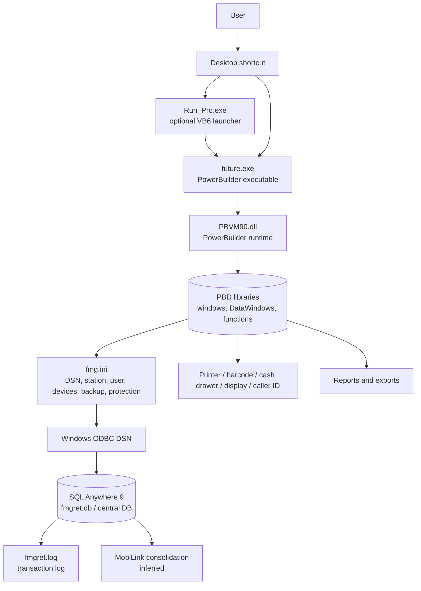
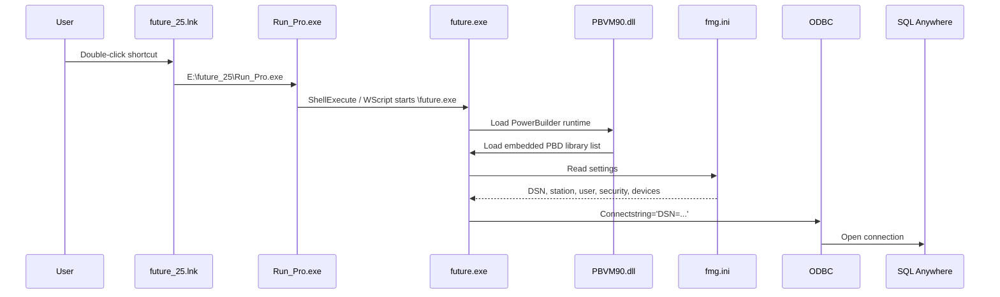
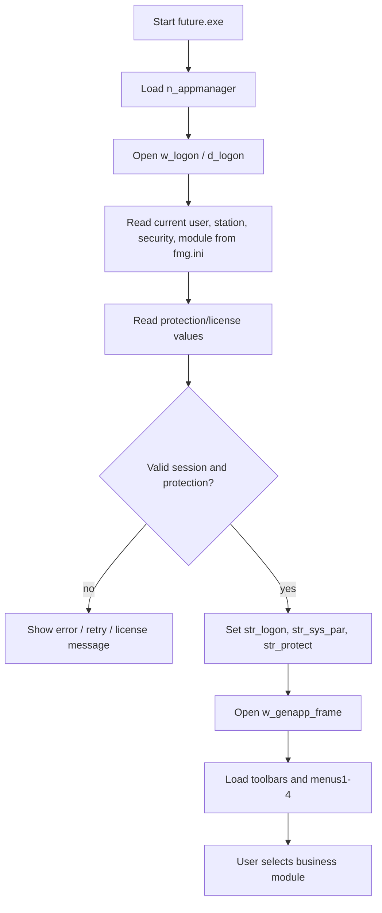
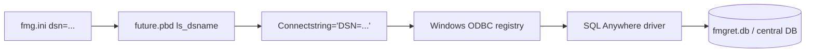
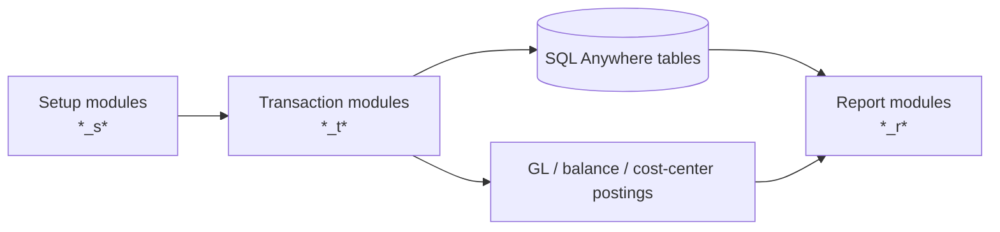
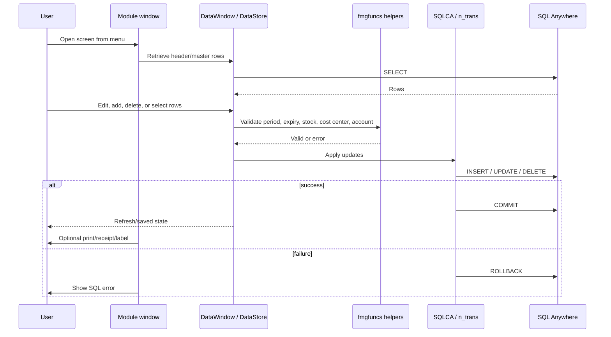
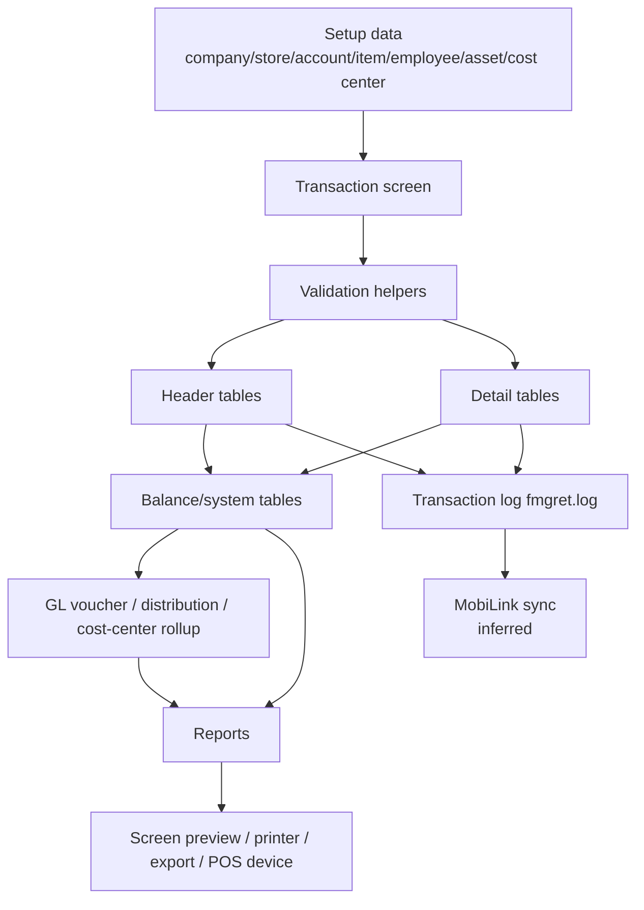
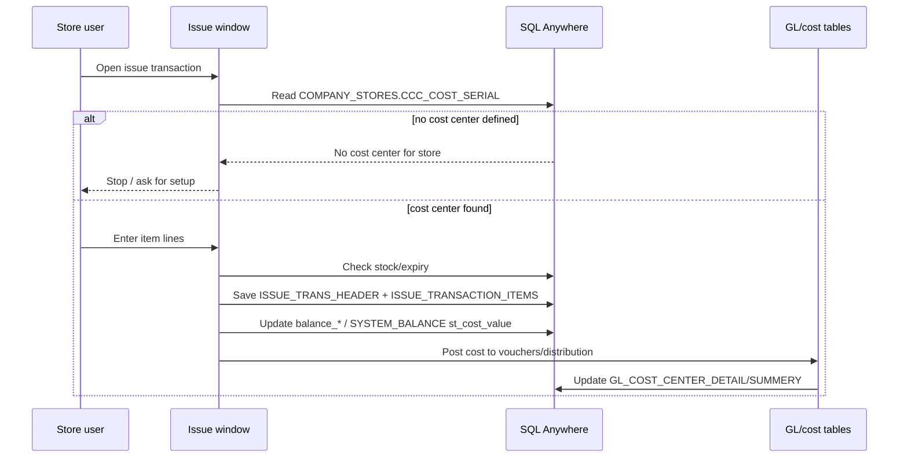
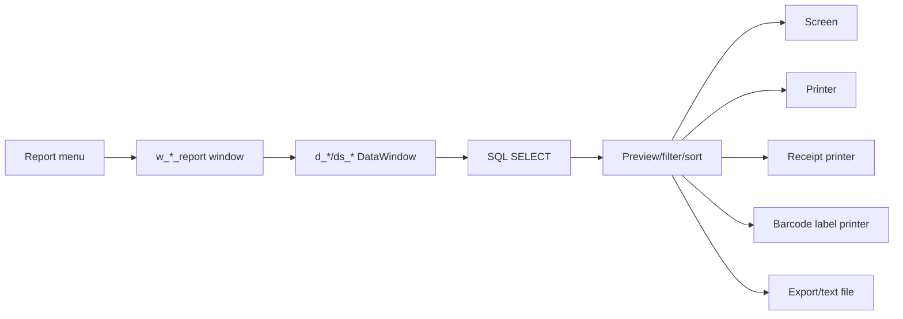
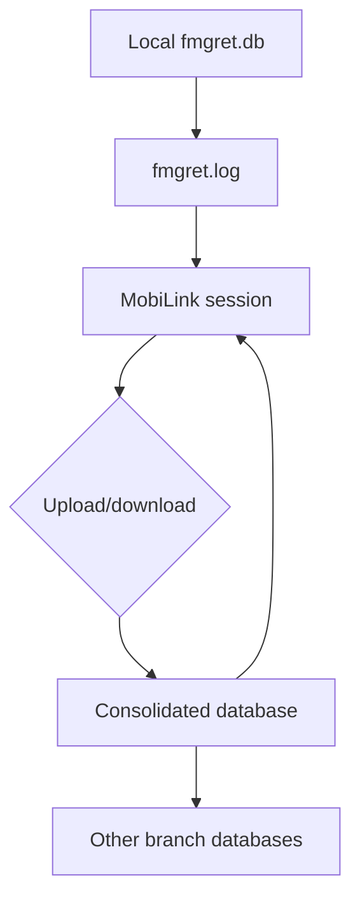

# Future 25 — how the app works

**Date:** 2026-11-25  
**Scope:** static analysis of `D:\future_25 old`, `D:\future_25 - Special`, `D:\future_25`, and `D:\Future Elshamy`  
**Safety:** no executable was launched; no file on `D:` was modified.  
**Method:** REA static inspection of PE/shortcut artifacts, read-only PowerBuilder `.pbd` byte/string scans, `fmg.ini` inspection, and recovered SQL Anywhere DDL.

## Confidence legend

- **[O]** Observed directly in a static artifact.
- **[I]** Inferred from object names, config keys, SQL strings, schemas, and module structure.
- **[U]** Unknown; requires runtime trace, ODBC registry, source/PBD decompilation, or live database access.

> This is an **operating-model explanation**, not a user manual. Exact click paths, menu order, and screen labels were not observed at runtime.

---

## 1. One-minute summary

Future 25 is a **Windows desktop ERP/POS application** built with **PowerBuilder 9** **[O]**. It is not a web app and not an Electron app.

In simple terms, the app works like this:

```text
User opens shortcut
  -> optional VB6 launcher checks/starts the app
  -> future.exe loads the PowerBuilder runtime
  -> PowerBuilder loads compiled PBD libraries
  -> fmg.ini supplies DSN, station, user, device, backup, and protection settings
  -> ODBC connects to SQL Anywhere
  -> user logs in and opens module menus
  -> screens retrieve data with DataWindows
  -> user edits header/detail records
  -> helpers validate fiscal period, stock, cost center, balances, and permissions
  -> SQLCA writes INSERT/UPDATE/DELETE and commits
  -> reports, receipts, labels, and exports read back from the database
  -> transaction log records changes; MobiLink may synchronize branch data
  -> backup policy writes backups
```

The system is **database-centered**: most business state lives in SQL Anywhere tables, while the client contains the UI, validation, and posting logic in compiled PowerBuilder libraries **[O]/[I]**.

---

## 2. Big picture



### Main parts

| Part | What it is | Role |
|---|---|---|
| `future.exe` | PE32/x86 PowerBuilder executable | Main application host **[O]** |
| `Run_Pro.exe` | VB6 launcher in three copies | Starts/protects `future.exe` **[O]** |
| `PBVM90.dll` | PowerBuilder 9 runtime | Executes compiled PB objects **[O]** |
| `.pbd` libraries | Compiled PowerBuilder modules | UI, reports, functions, SQL **[O]** |
| `fmg.ini` | Text configuration file | Tells the app where and how to run **[O]** |
| ODBC DSN | Windows data-source configuration | Resolves the DB driver/host **[O]/[I]** |
| SQL Anywhere DB | Business database | Stores all operational data **[O]** |
| `fmgret.log` | SQL Anywhere transaction log | Records DB changes; used for recovery **[O]** |
| MobiLink objects | Sync metadata in DB | Suggests branch consolidation **[O]/[I]** |

---

## 3. Startup: how the app is opened

### 3.1 Standard copies

Applies to `D:\future_25 old`, `D:\future_25 - Special`, and `D:\future_25` **[O]**.



Observed evidence:

- Shortcut target is `E:\future_25\Run_Pro.exe`, working directory `E:\future_25` **[O]**.
- `Run_Pro.exe` imports `MSVBVM60.DLL`, so it is Visual Basic 6 **[O]**.
- `Run_Pro.exe` strings include `\future.exe`, `ShellExecuteA`, `WScript.Shell`, `Run_Pro`, `Future 2010 Security`, and `Future Error` **[O]**.
- `future.exe` imports `PBVM90.dll` and embeds 105 `.pbd` references **[O]**.

Interpretation **[I]**: `Run_Pro.exe` acts as a small launcher/security wrapper before the real PowerBuilder program. Exact license checks are unknown **[U]**.

### 3.2 Elshamy copy

The Elshamy shortcut points directly to `D:\future25\future.exe` **[O]**.

```text
Shortcut -> future.exe -> PBVM90.dll -> PBDs -> fmg.ini -> ODBC -> SQL Anywhere
```

This copy also includes the actual database files:

- `D:\Future Elshamy\future25\Data\fmgret.db`
- `D:\Future Elshamy\future25\Data\fmgret.log`

So Elshamy looks like a working/installation copy with local data **[O]**.

---

## 4. What happens after launch

Once `future.exe` starts, the application follows this internal sequence **[I]** from observed objects:



Observed shell objects in `future.pbd` **[O]**:

| Object | Role |
|---|---|
| `w_logon`, `d_logon`, `d_logonold` | Login UI |
| `w_sec`, `w_protect`, `change_pass.fun` | Security/protection UI |
| `of_securety23.fun`, `of_protection.fun`, `of_end_protection.fun` | Protection helpers |
| `f_encrypte_x.fun`, `f_decrypte_x.fun` | Encryption/obfuscation helpers |
| `str_logon`, `str_sys_par`, `str_protect`, `str_serial` | Session state structures |
| `n_appmanager`, `n_version`, `n_osapi` | Application manager/version/OS helpers |
| `w_genapp_frame_*`, `w_genapp_toolbars*` | Main frame and toolbars |
| `w_menu_new_arb`, `w_menu_new_eng` | Arabic/English menu windows |

---

## 5. How configuration controls the app

`fmg.ini` is the main runtime control file **[O]**. It is read after startup and before normal module use **[I]**.

### 5.1 Important sections

| Section | What it controls |
|---|---|
| `[database]` | DBMS, DSN, login id, auto-commit |
| `[Definition]` | Station ID and protection/handler values |
| `[Current]` | Current user, security level, module, display flags |
| `[Backup]` | Backup path, automatic backup flag, allowed missed backups |
| `[validate]` | Validation behavior |
| `[BarCodePrint]` | Barcode label format and printing |
| `[CustomerDisplay]` | Customer display device settings |
| `[CashDrawer]` | Cash drawer settings |
| `[ReceiptPrint]` | Receipt printer settings |
| `[purchaseitems]` | Purchasing defaults |
| `[CallCenter]`, `[CallerId]` | Call-center/caller-ID integration |
| `[future]` | Version and obfuscated protection values |

### 5.2 Database connection



Observed values **[O]**:

- `DBMS=ODBC`
- `dsn=SPICIAL_HQ` in the Special root config
- `dsn=store` in old/plain/nested Special configs
- `logid=dba`
- `AutoCommit=false`
- commented `dsn=future`, `dsn=rady`
- commented server `sengam`, database `fmgret5`, DBMS `MSS Microsoft SQL Server`

The actual DB host is not hardcoded as an IP; it is resolved through Windows ODBC configuration **[O]/[I]**.

---

## 6. How menus and modules are organized

There are **114 `.pbd` libraries** in the baseline copy **[O]**. `future.exe` embeds 105 of them, so a few on-disk libraries may be variants or used by companion executables **[O]/[I]**.

String-derived object totals **[O]**:

| Object type | Count |
|---|---:|
| Windows (`w_*.win`) | 874 |
| DataWindows/DataStores (`d_*.dwo`, `ds_*.dwo`) | 3,091 |
| User objects (`*.udo`) | 56 |
| Functions (`*.fun`) | 288 |
| Structures (`*.str`) | 72 |

### 6.1 Module families

| Family | Libraries | What it does |
|---|---:|---|
| `inv*` | 28 | Inventory, stores, item balances, issues/receipts/transfers, expiry, labels |
| `pay*` | 14 | HR/payroll, attendance, salary, allowances/deductions, payslips |
| `acc*` | 13 | Accounting, chart of accounts, vouchers, balances, cost centers, budgets |
| `fas*` | 12 | Fixed assets, depreciation, asset transfer |
| `sal*` | 8 | Customers, prices, sales/call-center reporting |
| `pur*` | 7 | Vendors, purchase orders, requisitions |
| `gen*` | 2 | General setup, system parameters, security templates |
| `future*` | 2 | Shell, login, security, protection, dropdowns |
| `common`, `fmgances`, `fmgfuncs` | 3 | Shared UI base, helper functions, DataWindows |
| `menus1`–`menus4`, `XXmenus3` | 5 | Compiled menus |
| `mt*`, `MMmt*`, `XXmt*` | 17 | Maintenance/custom transaction variants |
| `rep_branchs`, `rlcomm`, `tr_data` | 3 | Support scripts, communications, transaction data |

### 6.2 Setup → transaction → report pattern

Most business domains follow the same pattern **[I]**:



Examples:

| Domain | Setup | Transaction | Report |
|---|---|---|---|
| Accounting | `acc_s1`, `acc_s2` | `acc_t1`–`acc_t4` | `acc_r1`–`acc_r6` |
| Inventory | `inv_s1`–`inv_s3` | `inv_t1`–`inv_t7` | `inv_r1`–`inv_r14` |
| Payroll | `pay_s1`–`pay_s3` | `pay_t1`–`pay_t4` | `pay_r1`–`pay_r4` |
| Purchasing | `pur_s1`, `pur_s2` | `pur_t1` | `pur_r1`, `pur_r2` |
| Fixed assets | `fas_s1`, `fas_s2` | `fas_t1`, `fas_t2` | `fas_r1`–`fas_r3` |
| Sales | `sal_s1`–`sal_s3` | `sal_t1`, `sal_t2` | `sal_r1`, `sal_r2` |

---

## 7. How a normal screen works

The application uses PowerBuilder windows and DataWindows **[O]**. A typical screen is built from reusable base objects in `fmgances.pbd`, such as:

- `w_header_lines`, `w_header_lines_2`
- `w_master_detail`, `w_master_detail_tab`
- `w_generic_choice`, `w_base_choice`
- `uo_dw_master`, `uo_dw_detail`
- `uo_dw_header_master`, `uo_dw_header_detail`
- `uo_dw_finder`, `uo_dw_sorter`
- `n_trans`, `n_dbasehandle`

### 7.1 Generic screen lifecycle



Observed support **[O]**:

- `fmgfuncs.pbd` contains `f_build_where`, `f_db_col_names`, `f_fill_db_info`, `f_copy_dw`, `f_company_fiscal_month`, `f_company_fiscal_year`, `f_check_expiry_balance`.
- PBD strings frequently contain `sqlca`, `sqlcode`, `sqldbcode`, `sqlerrtext`, `sqlsyntax`, `setsqlselect`, and `getsqlselect`.
- `AutoCommit=false` means the application controls commit/rollback **[O]/[I]**.

---

## 8. How data moves through the app



### 8.1 Main data groups

| Data group | Example tables |
|---|---|
| Organization/setup | `COMPANY`, `STORES`, `COMPANY_STORES`, `USER_COMPANY_STORE`, `CURRENCY` |
| Items/pricing | `ITEM_MASTER`, `ITEM_GROUPS`, `ITEM_COMPANY`, `ITEM_STORE_COMPANY`, price tables |
| Accounting/GL | `CHART_OF_ACCOUNTS`, `COMPANY_CHART_OF_ACCOUNT`, `GL_JOURNAL_VOUCHER_HEADER`, `GL_JOURNAL_VOUCHER_DETAIL` |
| Cost control | `COST_CENTERS`, `COMPANY_COST_CENTERS`, `GL_COST_CENTER_DETAIL`, `GL_COST_CENTER_SUMMERY`, `GL_BUDGET` |
| Inventory | `ISSUE_TRANS_HEADER`, `ISSUE_TRANSACTION_ITEMS`, `BALANCE_*`, `SYSTEM_BALANCE` |
| Sales/retail | `RATR_TRANSACTION_HEADER`, `RATR_TRANSACTION_ITEMS`, `RATR_TRANSACTION_HEADER_COST` |
| Purchasing | `VENDOR`, `COMPANY_VENDORS`, `PURCHASE_ORDER_HEADER`, vendor-item tables |
| Payroll | `EMPLOYEE`, `ATTENDANCE`, `TIME_SHEET_TRANSACTION`, `PAYSLIP_MONTHLY_COPY` |
| Fixed assets | `fa_asset_card`, `fa_asset_trans_detail`, `fa_dep_journal_voucher_detail` |

Full DDL: `future25_schema.sql`.

---

## 9. Module-by-module “how it works”

### 9.1 Accounting

```text
Maintain company, accounts, fiscal periods, cost centers, budgets
  -> open voucher/cash/paper transaction screen
  -> select company, account, fiscal period, cost center
  -> enter debit/credit header and detail lines
  -> validate account and cost-center mapping
  -> save GL_JOURNAL_VOUCHER_HEADER/DETAIL
  -> save distribution rows when split across sources/cost centers
  -> update balances / cost-center summary
  -> run trial balance, aging, cost-center, or budget report
```

Evidence **[O]**: `acc_*` libraries; GL tables; report windows such as `w_acc_cost_center_report_*`, `w_budget_report_*`, `w_traial_balance_*`.

### 9.2 Inventory and stores

```text
Maintain items, groups, units, stores, prices, expiry settings
  -> open receipt/issue/transfer/return/adjustment screen
  -> select store and transaction type
  -> enter item lines with quantities and costs
  -> check stock, expiry, and store cost-center mapping
  -> save issue/receive/transfer header and detail tables
  -> update balance_* and system_balance
  -> print label/receipt if configured
  -> run stock/balance/cost reports
```

Evidence **[O]**: `inv_*` libraries; `ITEM_MASTER`, `ISSUE_TRANS_HEADER`, `ISSUE_TRANSACTION_ITEMS`, `BALANCE_*`, `SYSTEM_BALANCE`; helper `f_check_expiry_balance`.

### 9.3 Sales / retail

```text
Maintain customers, customer-company links, prices, contracts
  -> open sales/call-center/customer help screen
  -> select customer, store, items, prices/discounts
  -> check availability
  -> save sales/retail transaction header and item lines
  -> calculate cost value/distribution where applicable
  -> print receipt/invoice
  -> run aging, customer, or sales analysis report
```

Evidence **[O]**: `sal_*` libraries; `CUSTOMER`, `RATR_TRANSACTION_HEADER`, `RATR_TRANSACTION_ITEMS`, `RATR_TRANSACTION_HEADER_COST`.

### 9.4 Purchasing

```text
Maintain vendors, company-vendor links, vendor-item prices
  -> open purchase order or requisition screen
  -> select vendor/company/store/items
  -> enter quantities, prices, tax, transport, expenses
  -> save purchase order/requisition tables
  -> receipt/update inventory when goods arrive
  -> run PO/vendor/purchase reports
```

Evidence **[O]**: `pur_*` libraries; `VENDOR`, `COMPANY_VENDORS`, `ITEM_COMPANY_VENDOR`, `PURCHASE_ORDER_HEADER`, `PURCHASE_ORDER_DETAIL`.

### 9.5 Payroll / HR

```text
Maintain employees, banks, grades, holidays, allowances/deductions
  -> record attendance/time sheets
  -> assign/validate employee cost center
  -> calculate salary and deductions
  -> save payslip/monthly copy and related tables
  -> post payroll through JV setup with cost-center flag
  -> print payslip/payroll reports
```

Evidence **[O]**: `pay_*` libraries; `EMPLOYEE`, `TIME_SHEET_TRANSACTION`, `ATTENDANCE`, `PAYSLIP_MONTHLY_COPY`, `payroll_jv_acc_header_setup`.

### 9.6 Fixed assets

```text
Maintain asset classes, cards, equations, opening balances
  -> add/acquire/transfer/adjust asset
  -> validate asset cost center for company
  -> calculate depreciation
  -> post depreciation JV with debit/credit cost centers
  -> print asset labels or run asset reports
```

Evidence **[O]**: `fas_*` libraries; `fa_asset_card`, `fa_asset_trans_detail`, `fa_dep_journal_voucher_detail`; messages such as `Cost center is the same as the old one`.

### 9.7 Cost control

```text
Maintain six-level cost-center tree
  -> define company cost centers
  -> map accounts, stores, employees, payroll setup, and assets to cost centers
  -> enter transactions with cost center
  -> store cost center in CCC_COST_SERIAL / RIGHT_CCC_COST_SERIAL
  -> distribute voucher lines to source modules
  -> roll up monthly into GL_COST_CENTER_DETAIL/SUMMERY
  -> compare GL_BUDGET budget vs actual
```

Detailed document: `future_25_cost_control.md`.

---

## 10. End-to-end walkthrough examples

### 10.1 Inventory issue to a cost center



Evidence: store cost-center errors and schema fields **[O]**; posting sequence **[I]**.

### 10.2 GL voucher posting

```text
Open GL voucher screen
  -> choose company, fiscal period, currency
  -> choose debit/credit accounts
  -> system checks company_chart_of_account cost-center definition
  -> enter CCC_COST_SERIAL and optional RIGHT_CCC_COST_SERIAL
  -> save GL_JOURNAL_VOUCHER_DETAIL
  -> if split, save GL_VOUCHER_DETAIL_DIST rows
  -> update balances/cost-center rollups
  -> trial balance/cost-center reports read the posted data
```

### 10.3 Sales transaction

```text
Open sales/customer screen
  -> select customer and store
  -> select items/prices
  -> validate stock/discount/customer terms
  -> save RATR_TRANSACTION_HEADER and RATR_TRANSACTION_ITEMS
  -> calculate RECORD cost value/percent where used
  -> print receipt/invoice
  -> sales/cost reports read the saved transaction
```

### 10.4 Payroll posting

```text
Set up employee and cost center
  -> record attendance/time sheet
  -> calculate salary
  -> payroll JV setup determines account and cost-center flag
  -> post payroll amounts with cost center
  -> include in GL/cost-center reports
```

### 10.5 Budget review

```text
Maintain GL_BUDGET by company/account/year/month
  -> transactions post actual amounts
  -> run Budget Report
  -> compare B_BUDGET_AMNT / B_BUDGET_BASE_AMNT with B_ACTUAL_AMNT / B_ACTUAL_BASE_AMNT
  -> filter by accounts linked to cost centers
```

---

## 11. Validation and error handling

Observed validation themes **[O]**:

| Area | Typical check |
|---|---|
| Fiscal period | company fiscal year/month helpers |
| Stock | expiry/balance checks |
| Cost center | must exist for company/store/account |
| Accounts | account must have cost-center type defined |
| Fixed assets | transfer cannot use same cost center |
| SQL | SQLCode/SQLErrText shown to user |
| License/protection | trial count and B-CONNECT message |

Examples of observed messages **[O]**:

- `You must choose a cost center`
- `This Cost Center is not defined for this company`
- `Cost center type is not defined for this account...`
- `There is no Cost Center defined for this store`
- `Cost center is the same as the old one`
- `You have exceeded the number of trials, Please call B-CONNECT`

Typical inferred failure path **[I]**:

```text
Validation or SQL fails
  -> SQLCA.sqlcode / sqlerrtext populated
  -> module displays error
  -> transaction rolled back
  -> user corrects and retries
```

Exact branches are unknown **[U]**.

---

## 12. Reports, printing, and devices



Observed **[O]**:

- Many `w_*_report_arb/eng.win` windows.
- Reusable print windows such as `w_print_generic`, `w_print_shared_dw`.
- Label DataWindows in `common.pbd` and `future.pbd`.
- `fmg.ini` sections for `BarCodePrint`, `CustomerDisplay`, `CashDrawer`, `ReceiptPrint`, `CallCenter`, and `CallerId`.
- `run_scripts.exe` references `rep_branchs.pbd` and `w_run_scripts_support_25.win`.

Inference **[I]**: reporting is DataWindow-centric; device output is configured externally in `fmg.ini`.

---

## 13. Synchronization and backup

### 13.1 Synchronization

Evidence from `fmgret.db` and recovered DDL **[O]**:

- SQL Anywhere 9 / Adaptive Server Anywhere.
- MobiLink objects: `ml_script_version`, `ml_add_connection_script`, `ml_add_table_script`, `ml_set_device_address`.
- Publications, subscriptions, `sync_id`, `consolidate`, `synchronize`.



Unknown **[U]**: endpoint, protocol, schedule, publication membership, and whether a separate sync executable is installed.

### 13.2 Backup

Observed config **[O]**:

```text
[Backup]
Path = F:\backup
auto = 1
missed_allowed = 3
```

Inferred behavior **[I]**:

```text
session/end-of-day
  -> if auto=1, write backup to F:\backup
  -> if success, continue
  -> if failure, increment missed count
  -> if missed >= allowed, warn/limit/block
```

Exact enforcement is unknown **[U]**.

---

## 14. What changes when using different copies

| Copy | How it works differently |
|---|---|
| `future_25 old` | Shortcut starts `Run_Pro.exe`; `dsn=store`; 114 PBDs |
| `future_25` | Same standard chain; `dsn=store`; 114 PBDs |
| `future_25 - Special` | Same chain; root `dsn=SPICIAL_HQ`; nested copy uses `dsn=store`; includes `run_scripts.exe`; Special has two identical 114-PBD sets |
| `Future Elshamy` | Shortcut starts `future.exe` directly; includes `fmgret.db` and `fmgret.log`; DSNs are commented |

Interpretation **[I]**:

- old/plain are standard branch deployments,
- Special is a customized/superset deployment,
- Elshamy is the only copy with actual DB data.

---

## 15. Important limitations

This document is based on static evidence only.

Not established **[U]**:

- actual runtime click paths,
- exact menu hierarchy,
- exact SQL execution timing,
- PowerBuilder event-script logic inside PBD bytecode,
- real ODBC server names/hosts,
- MobiLink server address and schedule,
- license/protection algorithm,
- device behavior,
- exact backup enforcement.

No executable was launched and no file on `D:` was modified.

---

## 16. Related documents

- Architecture: `future_25_architecture.md`
- Module catalog: `future_25_app_modules.md`
- General workflow: `future_25_app_workflow.md`
- UI map: `future_25_app_ui.md`
- Cost-control focus: `future_25_cost_control.md`
- Static analysis: `future_25_static_analysis.md`
- Full recovered schema: `future25_schema.sql`
- Schema report: `future25_schema_report.md`
- REA evidence bundle: `future_25_rea_evidence.json`

---

## 17. Bottom line

Future 25 works as a **PowerBuilder desktop ERP/POS client** that:

1. starts through a launcher or directly,
2. loads compiled PBD modules,
3. reads `fmg.ini`,
4. connects through ODBC to SQL Anywhere,
5. logs in and opens module menus,
6. uses DataWindows to retrieve and edit data,
7. validates business rules with shared helper functions,
8. commits transactions through SQLCA,
9. writes to core tables for accounting, inventory, sales, purchasing, payroll, assets, and cost control,
10. produces reports, labels, receipts, and exports,
11. records changes in the transaction log,
12. may synchronize branch data through MobiLink,
13. follows a configured backup policy.

Most detailed business logic is compiled into the PBD libraries; the database holds the operational state; `fmg.ini` controls where and how the client connects and behaves.
